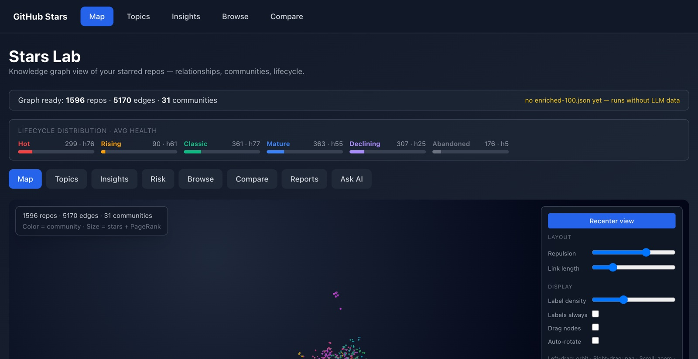
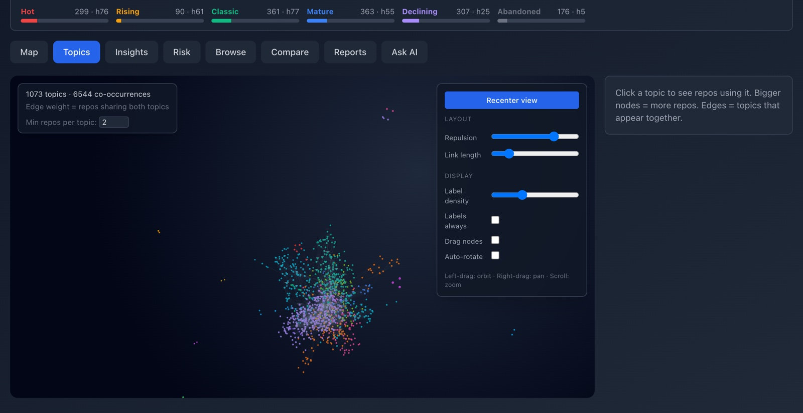
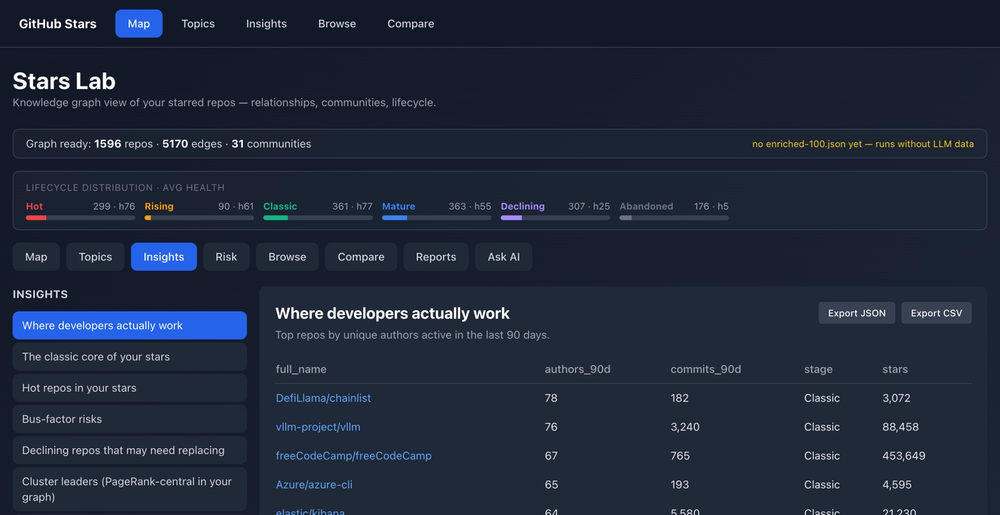
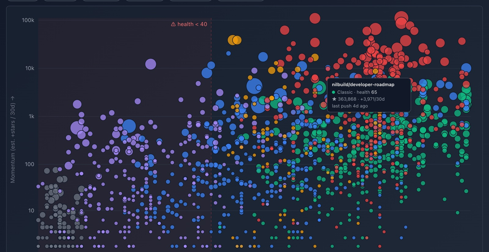
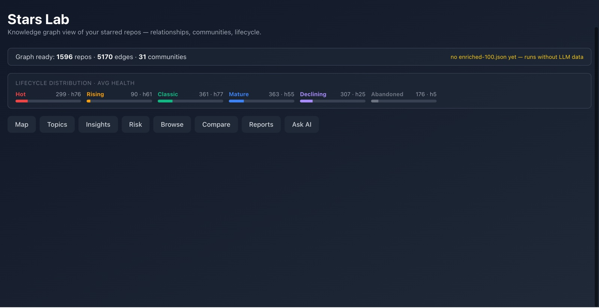
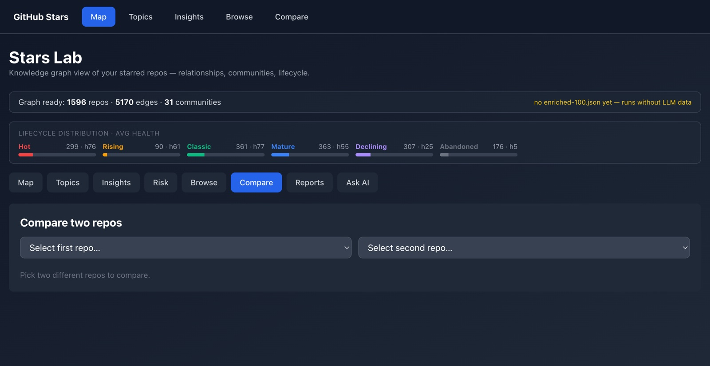
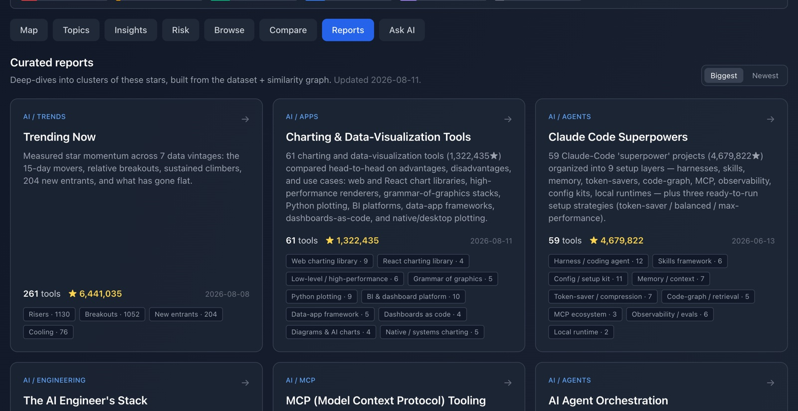
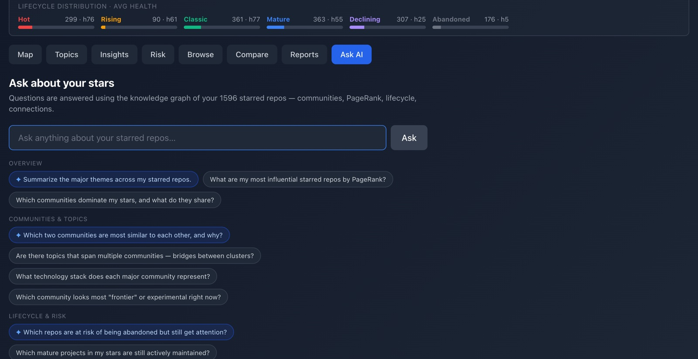

# GitHub Astrolab

**Your GitHub stars, turned into a decision tool.** Astrolab maps every repo you
have starred into a 3D knowledge graph, scores each one's health and lifecycle, and
writes curated landscape reports that answer *"which tool should I use for X?"*,
using only repos you have already vetted.

**[→ Open the live app](https://star-astrolab.vercel.app)** · no sign-up, no install

Currently mapping **2,408 starred repos** · 7,966 similarity edges · 39 communities · 29 landscape reports · refreshed weekly.



---

## Why

Stars are write-only memory. After a thousand of them you can't answer basic
questions: *what did I actually save about RAG? which of these is dead? if I need a
chart library today, which one do I already know about?*

Astrolab answers them. It does all the work offline at build time, with no LLM in
the hot path. You get a graph you can fly through, reports you can read, and a
search box you can ask.

| You want to… | Astrolab gives you |
|---|---|
| Pick a library for a new project | A landscape report ranking the candidates per task, with advantages, drawbacks and "best for" |
| Avoid adopting a dying dependency | Lifecycle stage, health score and bus factor side by side in **Risk** |
| See what's gaining momentum | Week-over-week star deltas and the *Trending Now* report |
| Find what you're missing | A discovery pass that searches GitHub for repos that belong in a report but aren't in your stars |
| Feed your tools and agents | Plain JSON and Markdown outputs that other projects and skills build on (see below) |

---

## Features

### Map — the 3D knowledge graph

Every star as a node, positioned by a force simulation that runs at build time, not
in your browser. Color is community, size is stars + PageRank. Click to focus, drag
to orbit.


### Topics — what your stars are *about*

A co-occurrence graph of tags across the corpus. Shows the shape of your interests
rather than the individual repos.



### Insights — named questions, answered

Prewritten analytical queries over the dataset: where developers actually work
(by 90-day author counts), the classic core of your stars, hot repos, bus-factor
risks, declining projects worth replacing, and PageRank-central cluster leaders.
Every view exports to JSON or CSV.



### Risk — what's quietly dying

Lifecycle stage, health score, bus factor, and top-author concentration surfaced
together, so single-maintainer and abandoned dependencies stand out before you
adopt them.



### Browse — the whole corpus, filtered

Searchable and sortable across every metric in the dataset: stars, forks, language,
lifecycle, health, activity.



### Compare — two repos, side by side

Full metric comparison plus the **shortest path between them through the graph** —
which shared topics, authors, or intermediaries connect two projects.



### Reports — 29 curated landscape reports

The largest feature. Each report is a **deterministic Python generator** over the
local dataset — hand-curated taxonomies, master comparison tables, per-task
rankings, graph analysis, and maintenance risk. No API calls at generation time,
so they're fully reproducible and cost nothing to rebuild.

Covering RAG tooling, agent harnesses, MCP servers, document extraction, LLM
evaluation, voice agents, fine-tuning stacks, charting libraries, trending
momentum, and more.



### Ask AI — natural language over the graph

Questions answered with the graph's community summary as grounding context, via
any OpenAI-compatible endpoint. Optional — every other tab works without a key.



---

## Built with Astrolab

The dataset and reports are plain files (`data/classified.json`,
`public/data/graph.json`, `reports/*.md`), so other projects can build on them.
These are the ones that did.

### New projects built on its data or engine

- **hoshi** *(private)*: a self-hosted graph-vector index answering *"what existing
  repos solve this problem?"*, with the license on every hit. It was seeded from
  Astrolab's `classified.json` and similarity graph and now indexes 1,873 repos.
- **hf-models-analyzer** *(in progress)*: the same engine pointed at Hugging Face.
  It answers *"given this task, this VRAM budget and this license, what should I
  run?"* across 1,131 models and 1,198 datasets. It reuses the build-time
  precompute, the Python report orchestrator and the hard-won GitHub-client
  lessons.
- **Repo-picker skills** *(private)*: Claude Code skills that turn a landscape
  report into a reusable "which tool for X" advisor. Each one routes a use case
  into the report's curated prose, then adds live health data (Active / Stable /
  Slowing / Stalled). `scripts/build_viz_skill.py` in this repo generates the
  chart-library picker and re-generates it after every data refresh.

### Other repos and workflows it improved

- **[kogitsune](https://github.com/kaiser-data/kogitsune)**: a launcher for lean
  Claude Code sessions. It came out of reading the *Claude Code setups* report,
  which showed that per-session skill selection was the gap no starred tool
  filled. The repo was started the same day (2026-06-15).
- **Stack decisions in new projects**: reports get copied into other projects
  as their tool-choice reference. For example, the *NotebookLM stack* report
  (33 tools in 8 categories) became the design doc for one project's ingestion,
  retrieval and TTS picks.
- **Chart-library choice everywhere**: the picker skill answers "what should I
  chart this with?" from the *Charting stack* report while working in any other
  repo.
- **Keeping the stars themselves useful**: `scripts/discover.mjs` searches
  GitHub for repos that belong in a report but are missing from the stars, and
  approved ones get starred. One pass added 14. The weekly refresh warns about
  any curated repo that was renamed or deleted upstream.

---

## Architecture

The whole design principle: **do the expensive work at build time, ship a static file.**

```
GitHub API
    ↓
scripts/sample.mjs       # list the stars
scripts/ingest.mjs       # fetch full repo + author data
scripts/classify.mjs     # lifecycle stage + health score (no LLM)
scripts/precompute.mjs   # kNN graph + Louvain communities + PageRank
                         # + 300-tick force simulation → frozen positions
    ↓
public/data/
  graph.json             # ~1.8 MB — nodes/links ready for the browser
  graph-context.json     # compact community summary for LLM grounding
    ↓
scripts/reports/*.py     # 29 generators → reports/*.md + meta sidecars
scripts/reports/build_index.py
                         # snapshots the vintage, regenerates every report,
                         # injects chart SVGs, writes public/reports/index.json

Browser (React + Three.js)
  → loads graph.json and renders immediately (zero graph math in the browser)

Vercel Function /api/ask
  → loads graph-context.json, calls any OpenAI-compatible endpoint,
    behind a daily/weekly spend cap kept in Upstash Redis
```

Snapshots in `data/snapshots/` (one per vintage) power the ▲/▼ star-trend deltas
and the momentum-based *Trending Now* report.

---

## Quick start

```bash
npm install
cp .env.example .env          # add GITHUB_TOKEN
npm run refresh               # fetch → classify → precompute
npm run dev                   # → http://localhost:5173
```

The repo ships with committed data, so `npm run dev` works before you ever run
`refresh` — you'll just be looking at someone else's stars.

---

## Data pipeline

```bash
npm run refresh               # full chain: sample → ingest → classify → precompute
npm run precompute            # rebuild graph.json from existing classified.json
npm run reports               # regenerate all 29 reports + index
```

`refresh` needs `GITHUB_TOKEN` in `.env` (a classic PAT with no scopes is enough —
it reads public data; the token exists for the 5,000/hr rate limit). Everything
downstream of `ingest` runs entirely offline.

| Script | Input | Output |
|--------|-------|--------|
| `scripts/sample.mjs` | GitHub username | `src/data/sample-all.json` (star list) |
| `scripts/ingest.mjs` | sample + `--max-age` | `src/data/raw-all.json` (full repo data) |
| `scripts/classify.mjs` | raw JSON | `classified-all.json` (lifecycle + health) |
| `scripts/precompute.mjs` | classified JSON | `graph.json` + `graph-context.json` |
| `scripts/reports/build_index.py` | classified + graph | `reports/*.md` + `public/reports/index.json` |

A GitHub Action (`.github/workflows/refresh-data.yml`) runs the whole chain weekly
and pushes the result; `.github/workflows/deploy.yml` then ships it to Vercel. The
refresh needs one repo secret, `GH_STARS_TOKEN` (deploy secrets: see [Deploy](#deploy)).

---

## Writing a report

Reports are curated by hand, not generated by an LLM. `scripts/reports/rag_tooling.py`
is the canonical template:

```python
TAXONOMY = {"owner/repo": ("Category", "one-line blurb"), …}
ADJACENT = [(name, "why it's excluded"), …]
```

Then register the file in `GENERATORS` in `build_index.py` and run it. The generator
prints `tools: N / N curated` and warns on any curated name missing from the dataset —
that warning is how you catch upstream repo renames.

`scripts/reports/render_html.py` renders any report as a standalone, fully inlined
HTML page (CSS and chart SVGs embedded, works offline).

---

## Ask AI setup

Provider-agnostic: the Vercel Function (`api/ask.mjs`) talks to any
**OpenAI-compatible** chat-completions endpoint. The live site runs Nebius Token
Factory with `Qwen/Qwen3-235B-A22B-Instruct-2507`.

| Var            | Required | Default                                      |
|----------------|----------|----------------------------------------------|
| `LLM_API_KEY`  | yes      | —                                            |
| `LLM_BASE_URL` | no       | `https://api.z.ai/api/coding/paas/v4`        |
| `LLM_MODEL`    | no       | `glm-4.6`                                    |

**Spend cap.** Every request reserves its estimated cost against a daily and a
weekly budget held in Redis, so the cap holds across serverless instances. With a
cap set but no reachable store, requests are refused (fails closed).

| Var                                  | Default | Purpose                                   |
|--------------------------------------|---------|-------------------------------------------|
| `BUDGET_DAILY_USD`                   | `1`     | daily cap (`0` disables)                  |
| `BUDGET_WEEKLY_USD`                  | `5`     | weekly cap (`0` disables)                 |
| `LLM_PRICE_IN_PER_M` / `_OUT_PER_M`  | `1` / `3` | USD per million tokens — keep in step with the model |
| `KV_REST_API_URL` + `KV_REST_API_TOKEN` | —    | Upstash Redis (or the `UPSTASH_REDIS_REST_*` names) |

On Vercel: `vercel env add <NAME> production`, then redeploy — env changes only
take effect on the next deploy. Locally, drop them into `.env`. Legacy `ZAI_*`
names still work as fallbacks.

<details>
<summary>Provider recipes</summary>

| Provider                | `LLM_BASE_URL`                                | Example `LLM_MODEL`                                  |
|-------------------------|-----------------------------------------------|------------------------------------------------------|
| **Z.AI Coding Plan**    | `https://api.z.ai/api/coding/paas/v4`         | `glm-4.6`                                            |
| Z.AI pay-as-you-go      | `https://api.z.ai/api/paas/v4`                | `glm-4.6`                                            |
| OpenAI                  | `https://api.openai.com/v1`                   | `gpt-4o-mini`                                        |
| Groq                    | `https://api.groq.com/openai/v1`              | `llama-3.3-70b-versatile`                            |
| Together                | `https://api.together.xyz/v1`                 | `meta-llama/Llama-3.3-70B-Instruct-Turbo`            |
| DeepSeek                | `https://api.deepseek.com/v1`                 | `deepseek-chat`                                      |
| Mistral                 | `https://api.mistral.ai/v1`                   | `mistral-small-latest`                               |
| OpenRouter (→ anything) | `https://openrouter.ai/api/v1`                | `anthropic/claude-sonnet-4-5`                        |
| Fireworks               | `https://api.fireworks.ai/inference/v1`       | `accounts/fireworks/models/llama-v3p3-70b-instruct`  |
| Local Ollama            | `http://localhost:11434/v1`                   | `llama3.2`                                           |

</details>

Without `LLM_API_KEY` the tab shows a configuration notice; everything else works
normally. Quota and billing errors are surfaced as a friendly notice, not a stack trace.

---

## Deploy

Hosted on Vercel; `vercel.json` holds the build command, rewrites, cache headers
and function config.

```bash
vercel link                   # once
vercel deploy --prod --yes    # manual production deploy
```

`.github/workflows/deploy.yml` deploys on every push to `main` and after each
weekly refresh. It needs three repo secrets: `VERCEL_TOKEN`, `VERCEL_ORG_ID` and
`VERCEL_PROJECT_ID` (the last two from `.vercel/project.json`).

`graph.json` and the reports are committed, so the build serves them without
running the pipeline.

---

## Tech stack

| Layer | Libraries |
|-------|-----------|
| UI | React 18, Tailwind CSS, Lucide |
| 3D graph | react-force-graph-3d, Three.js, d3-force-3d |
| Graph algorithms | graphology, graphology-communities-louvain, graphology-metrics |
| Data pipeline | Node.js ESM scripts, GitHub REST API |
| Reports | Python 3.12 (stdlib only — no dependencies) |
| LLM | Any OpenAI-compatible API |
| Hosting | Vercel (static + Functions), Upstash Redis for the spend cap |

---

## Project structure

```
scripts/
  sample.mjs          list stars for a user
  ingest.mjs          fetch full repo data from GitHub
  classify.mjs        lifecycle + health scoring
  precompute.mjs      graph build, simulation, LLM context
  reports/
    lib.py            shared formatting + snapshot/trend helpers
    build_index.py    orchestrator: snapshot → generate → charts → index
    render_html.py    markdown report → standalone HTML page
    *.py              29 report generators (one per landscape)

data/
  classified.json     classified dataset (committed)
  snapshots/          one per vintage — powers trend deltas

public/data/
  graph.json          pre-computed graph (committed)
  graph-context.json  LLM grounding context (committed)

src/lab/
  GraphProvider.jsx   loads graph.json, provides nodes/links via context
  MapView.jsx         3D force graph
  TopicMap.jsx        topic co-occurrence graph
  InsightFeed.jsx     named analytical queries
  AllRepos.jsx        searchable repo list
  Comparator.jsx      side-by-side comparison + path finding
  ReportsView.jsx     landscape report reader
  LabApp.jsx          tab routing + Ask AI UI

api/
  ask.mjs             POST /api/ask → any OpenAI-compatible endpoint

scripts/lib/
  spend-budget.mjs    daily/weekly spend cap backed by Upstash Redis
```

---

## License

MIT © Martin Kaiser
