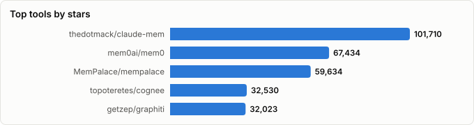
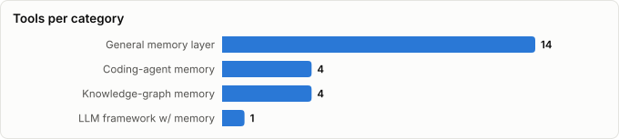

# Memory Frameworks for LLMs & Agents — Comparative Report

> Derived from **kaiser-data**'s 2,398 starred repos (snapshot `2026-10-19T11:27:31.266Z`), cross-referenced with the repo-similarity graph (2,398 nodes / 8,025 edges, 39 communities).
>
> Generated 2026-10-19 by `scripts/reports/memory_frameworks.py` (regenerate any time — no API cost).

## Executive summary

- **23 dedicated memory frameworks** identified across your stars, plus **5 storage substrates** (vector/graph DBs) they build on.
- Combined reach: **461,201★**. The space is overwhelmingly **Python** (10/23 projects).
- Four sub-categories emerge: **general memory layers**, **coding-agent/session memory**, **knowledge-graph memory**, and frameworks that **bundle a memory module**.
- The dominant architectural split is **vector-recall vs. knowledge-graph** memory — with a clear trend toward *temporal knowledge graphs* (graphiti) and *local-first* designs (OpenChronicle, ctx, TencentDB-Agent-Memory).

## Master comparison

Sorted by stars. `Health` and `Momentum` come from the dataset's computed metrics; `Activity` is derived from days-since-push + 90-day commits.

| Project | Category | Lang | License | ★ Stars | Lifecycle | Health | Activity | Last push | Age | Contrib(90d) |
|---|---|---|---|---|---|---|---|---|---|---|
| [thedotmack/claude-mem](https://github.com/thedotmack/claude-mem) | Coding-agent memory | TypeScript | Apache-2.0 | 101,710 (▲2,574) | Hot | 85 | very active | 0d ago | 1.1y | 24 |
| [mem0ai/mem0](https://github.com/mem0ai/mem0) | General memory layer | Python | Apache-2.0 | 67,434 (▲492) | Classic | 83 | very active | 2d ago | 3.3y | 29 |
| [MemPalace/mempalace](https://github.com/MemPalace/mempalace) | General memory layer | Python | MIT | 59,634 (▲142) | Rising | 76 | very active | 1d ago | 6mo | 1 |
| [topoteretes/cognee](https://github.com/topoteretes/cognee) | General memory layer | Python | Apache-2.0 | 32,530 (▲582) | Classic | 81 | very active | 0d ago | 3.2y | 8 |
| [getzep/graphiti](https://github.com/getzep/graphiti) | General memory layer | Python | Apache-2.0 | 32,023 (▲410) | Mature | 76 | very active | 0d ago | 2.2y | 13 |
| [TencentCloud/TencentDB-Agent-Memory](https://github.com/TencentCloud/TencentDB-Agent-Memory) | General memory layer | TypeScript | NOASSERTION | 29,614 (▲1,727) | Hot | 91 | very active | 0d ago | 6mo | 31 |
| [gastownhall/beads](https://github.com/gastownhall/beads) | Coding-agent memory | Go | MIT | 28,012 (▲232) | Hot | 76 | very active | 0d ago | 1.0y | 9 |
| [letta-ai/letta](https://github.com/letta-ai/letta) | General memory layer | — | Apache-2.0 | 25,187 (▲92) | Mature | 67 | active | 1d ago | 3.0y | 3 |
| [MemoriLabs/Memori](https://github.com/MemoriLabs/Memori) | General memory layer | Python | NOASSERTION | 17,149 (▲1) | Mature | 62 | active | 16d ago | 1.2y | 1 |
| [memvid/memvid](https://github.com/memvid/memvid) | General memory layer | Rust | Apache-2.0 | 16,603 (▲18) | Declining | 46 | slowing | 3mo ago | 1.4y | 0 |
| [semantica-agi/semantica](https://github.com/semantica-agi/semantica) | Knowledge-graph memory | Python | MIT | 14,133 (▲232) | Hot | 99 | very active | 0d ago | 1.3y | 30 |
| [andrewyng/context-hub](https://github.com/andrewyng/context-hub) | Coding-agent memory | JavaScript | MIT | 13,973 | Declining | 25 | slowing | 4mo ago | 11mo | 0 |
| [plastic-labs/honcho](https://github.com/plastic-labs/honcho) | General memory layer | Python | AGPL-3.0 | 7,684 (▲130) | Classic | 78 | very active | 2d ago | 3.1y | 20 |
| [memodb-io/Acontext](https://github.com/memodb-io/Acontext) | General memory layer | JavaScript | Apache-2.0 | 3,695 (▲2) | Declining | 45 | slowing | 3mo ago | 1.3y | 0 |
| [trustgraph-ai/trustgraph](https://github.com/trustgraph-ai/trustgraph) | Knowledge-graph memory | Python | Apache-2.0 | 2,816 (▲26) | Mature | 63 | very active | 1d ago | 2.3y | 8 |
| [Einsia/OpenChronicle](https://github.com/Einsia/OpenChronicle) | General memory layer | Python | MIT | 2,803 (▼13) | Declining | 19 | slowing | 5mo ago | 6mo | 0 |
| [MemTensor/memmy-agent](https://github.com/MemTensor/memmy-agent) | General memory layer | TypeScript | MIT | 2,113 (▲25) | Hot | 77 | very active | 0d ago | 3mo | 5 |
| [Asymptote-Labs/agent-beacon](https://github.com/Asymptote-Labs/agent-beacon) | Coding-agent memory | Go | MIT | 1,842 (▲29) | Hot | 83 | very active | 1d ago | 5mo | 6 |
| [shaneholloman/mcp-knowledge-graph](https://github.com/shaneholloman/mcp-knowledge-graph) | Knowledge-graph memory | JavaScript | MIT | 885 (▼3) | Declining | 39 | slowing | 4mo ago | 1.9y | 0 |
| [supermemoryai/openclaw-supermemory](https://github.com/supermemoryai/openclaw-supermemory) | General memory layer | TypeScript | — | 797 (▲1) | Rising | 49 | active | 10d ago | 8mo | 2 |
| [zmedelis/bosquet](https://github.com/zmedelis/bosquet) | LLM framework w/ memory | Clojure | EPL-1.0 | 381 | Mature | 46 | active | 19d ago | 3.8y | 2 |
| [needle-ai/needle-mcp](https://github.com/needle-ai/needle-mcp) | Knowledge-graph memory | Python | MIT | 104 (▲1) | Abandoned | 10 | stale | 1.2y ago | 1.8y | 0 |
| [ActiveMemory/ctx](https://github.com/ActiveMemory/ctx) | General memory layer | HTML | NOASSERTION | 79 | Hot | 77 | very active | 0d ago | 9mo | 7 |

## By category

### General memory layer

_Drop-in memory APIs for any agent: store interactions/facts, retrieve relevant context on demand. The crowded, fast-moving core of the space._

- **[mem0ai/mem0](https://github.com/mem0ai/mem0)** · 67,434★ · Python · Classic  
  Universal, LLM-agnostic memory API; extract+store+retrieve facts across sessions.  
  topics: ai, chatgpt, llm, python, rag, long-term-memory, memory, memory-management
- **[MemPalace/mempalace](https://github.com/MemPalace/mempalace)** · 59,634★ · Python · Rising  
  Benchmark-focused open-source memory system.  
  topics: ai, chromadb, llm, mcp, memory, python
- **[topoteretes/cognee](https://github.com/topoteretes/cognee)** · 32,530★ · Python · Classic  
  'Memory control plane' — ECL (extract-cognify-load) pipelines into a knowledge graph + vector store.  
  topics: ai, cognitive-architecture, vector-database, ai-agents, graph-database, ai-memory, cognitive-memory, knowledge
- **[getzep/graphiti](https://github.com/getzep/graphiti)** · 32,023★ · Python · Mature  
  Temporal knowledge graph engine behind Zep; bi-temporal edges, real-time incremental updates.  
  topics: agents, graph, llms, rag
- **[TencentCloud/TencentDB-Agent-Memory](https://github.com/TencentCloud/TencentDB-Agent-Memory)** · 29,614★ · TypeScript · Hot  
  Fully-local long-term memory via a 4-tier progressive pipeline.  
  topics: agent, llm, memory, openclaw-plugin, ai-agent, embedding, local-first, long-term-memory
- **[letta-ai/letta](https://github.com/letta-ai/letta)** · 25,187★ · — · Mature  
  Ex-MemGPT — the project that coined 'agent memory'; self-editing memory + a stateful agent server.  
  topics: llm, llm-agent, ai, ai-agents
- **[MemoriLabs/Memori](https://github.com/MemoriLabs/Memori)** · 17,149★ · Python · Mature  
  Agent-native memory infra; turns execution & conversations into structured recall.  
  topics: agent, ai, long-short-term-memory, memory, python, rag, state-management, memory-management
- **[memvid/memvid](https://github.com/memvid/memvid)** · 16,603★ · Rust · Declining  
  Serverless single-file memory layer; replaces RAG pipelines with a portable artifact.  
  topics: ai, context, embedded, faiss, knowledge-base, knowledge-graph, llm, machine-learning
- **[plastic-labs/honcho](https://github.com/plastic-labs/honcho)** · 7,684★ · Python · Classic  
  Memory library for stateful agents; user-modeling / theory-of-mind oriented.  
  topics: ai, llm, memory, agent-memory, ai-agents, ai-memory, context-engineering, continual-learning
- **[memodb-io/Acontext](https://github.com/memodb-io/Acontext)** · 3,695★ · JavaScript · Declining  
  Treats agent 'skills' as a memory layer.  
  topics: agent, context-engineering, data-platform, self-learning, agent-development-kit, ai-agent, llm, memory
- **[Einsia/OpenChronicle](https://github.com/Einsia/OpenChronicle)** · 2,803★ · Python · Declining  
  Local-first memory for any tool-capable LLM agent.  
  topics: —
- **[MemTensor/memmy-agent](https://github.com/MemTensor/memmy-agent)** · 2,113★ · TypeScript · Hot  
  Personal agent and local memory hub from the MemOS team — one shared memory any AI client can read.  
  topics: agent, ai-agents, memory, agentic-ai, llm, long-term-memory, personal-ai, chatgpt
- **[supermemoryai/openclaw-supermemory](https://github.com/supermemoryai/openclaw-supermemory)** · 797★ · TypeScript · Rising  
  Long-term memory & recall, packaged for OpenClaw agents.  
  topics: ai-memory, clawd, clawdbot, memory, moltbot, openai, openclaw
- **[ActiveMemory/ctx](https://github.com/ActiveMemory/ctx)** · 79★ · HTML · Hot  
  Single-binary, local-first 'convergent' memory for humans + machines.  
  topics: agent-infrastructure, ai-collaboration, ai-tooling, context-management, developer-tools, documentation, human-in-the-loop, knowledge-management

### Coding-agent memory

_Memory specialized for coding assistants (Claude Code, Cursor, OpenClaw): persist project context, decisions, and history across sessions._

- **[thedotmack/claude-mem](https://github.com/thedotmack/claude-mem)** · 101,710★ · TypeScript · Hot  
  Persistent context across sessions; captures everything an agent does and re-injects it.  
  topics: ai, ai-agents, ai-memory, anthropic, artificial-intelligence, claude, claude-agent-sdk, claude-agents
- **[gastownhall/beads](https://github.com/gastownhall/beads)** · 28,012★ · Go · Hot  
  Distributed graph issue-tracker as durable agent memory (Dolt-backed).  
  topics: agents, claude-code, coding
- **[andrewyng/context-hub](https://github.com/andrewyng/context-hub)** · 13,973★ · JavaScript · Declining  
  Curated, versioned docs so agents stop hallucinating APIs / forgetting.  
  topics: —
- **[Asymptote-Labs/agent-beacon](https://github.com/Asymptote-Labs/agent-beacon)** · 1,842★ · Go · Hot  
  Cross-harness, self-improving memory layer — one memory shared by Claude Code, Codex and other agents.  
  topics: security-tools, agent-ai-cli, agent-security, mobile-device-management, security-information-and-event-management, security, ci, cloud

### Knowledge-graph memory

_Memory as a structured graph/ontology rather than a vector blob — better provenance, reasoning, and explainability._

- **[semantica-agi/semantica](https://github.com/semantica-agi/semantica)** · 14,133★ · Python · Hot  
  AI-native KG framework: semantic retrieval, ontology reasoning, provenance.  
  topics: ai, ai-governance, artificial-intelligence, context-engineering, context-graphs, decision-intelligence, explainable-ai, generative-ai
- **[trustgraph-ai/trustgraph](https://github.com/trustgraph-ai/trustgraph)** · 2,816★ · Python · Mature  
  Agent runtime platform powered by context graphs + ontology.  
  topics: open-source, ontology, agent, graph, rdf, knowledge-graph, owl, context-graph
- **[shaneholloman/mcp-knowledge-graph](https://github.com/shaneholloman/mcp-knowledge-graph)** · 885★ · JavaScript · Declining  
  MCP server giving Claude persistent memory via a local knowledge graph.  
  topics: ai-memory, claude-ai, knowledge-graph, mcp, memory-server, typescript
- **[needle-ai/needle-mcp](https://github.com/needle-ai/needle-mcp)** · 104★ · Python · Abandoned  
  MCP server: long-term memory for LLMs via managed RAG.  
  topics: ai, mcp, modelcontextprotocol, rag, semantic-search

### LLM framework w/ memory

_Broader LLMOps toolkits that ship memory as one module._

- **[zmedelis/bosquet](https://github.com/zmedelis/bosquet)** · 381★ · Clojure · Mature  
  Clojure LLMOps toolkit; prompt composition + agents + LLM memory.  
  topics: clojure, gpt, prompt-engineering, llmops, ai

## Graph analysis — how they relate

**Community clustering.** The 23 frameworks fall into **8 of the graph's 39 communities** — meaning memory tooling does *not* form one tight cluster but is spread across the AI-infra landscape (each tends to cluster with its neighbors: vector DBs, agent frameworks, or MCP tooling).

- **Community 15** (15): `mem0ai/mem0`, `letta-ai/letta`, `topoteretes/cognee`, `getzep/graphiti`, `MemoriLabs/Memori`, `memvid/memvid`, `plastic-labs/honcho`, `TencentCloud/TencentDB-Agent-Memory`, `MemPalace/mempalace`, `MemTensor/memmy-agent`, `gastownhall/beads`, `andrewyng/context-hub`, `trustgraph-ai/trustgraph`, `semantica-agi/semantica`, `needle-ai/needle-mcp`
- **Community 17** (2): `supermemoryai/openclaw-supermemory`, `zmedelis/bosquet`

**Centrality (PageRank in the full 1,071-repo graph).** Higher = more connected to the rest of your starred ecosystem (a proxy for how 'hub-like' the project is):

- `MemPalace/mempalace` — PageRank 0.0007
- `letta-ai/letta` — PageRank 0.0006
- `plastic-labs/honcho` — PageRank 0.0005
- `mem0ai/mem0` — PageRank 0.0005
- `getzep/graphiti` — PageRank 0.0005
- `MemTensor/memmy-agent` — PageRank 0.0004
- `supermemoryai/openclaw-supermemory` — PageRank 0.0004
- `topoteretes/cognee` — PageRank 0.0004

**Direct links between memory frameworks** (similarity edges where both endpoints are in this report):

- `MemoriLabs/Memori` ⇄ `mem0ai/mem0` (w=0.330) — topics: ai, memory, python, rag
- `MemPalace/mempalace` ⇄ `plastic-labs/honcho` (w=0.281) — topics: ai, llm, memory
- `plastic-labs/honcho` ⇄ `topoteretes/cognee` (w=0.258) — topics: ai, agent-memory, ai-agents, ai-memory
- `TencentCloud/TencentDB-Agent-Memory` ⇄ `memodb-io/Acontext` (w=0.200) — topics: agent, llm, memory, ai-agent

## Maintenance & risk signal

Bus factor = how concentrated commits are in one author (1 = single-maintainer risk). Use alongside lifecycle + activity before adopting.

| Project | Health | Lifecycle | Activity | Bus factor | Top-author share | Releases |
|---|---|---|---|---|---|---|
| semantica-agi/semantica | 99 | Hot | very active | 5 | 17% | 24 |
| TencentCloud/TencentDB-Agent-Memory | 91 | Hot | very active | 5 | 18% | 21 |
| thedotmack/claude-mem | 85 | Hot | very active | 2 | 32% | 370 |
| mem0ai/mem0 | 83 | Classic | very active | 2 | 46% | 416 |
| Asymptote-Labs/agent-beacon | 83 | Hot | very active | 2 | 31% | 156 |
| topoteretes/cognee | 81 | Classic | very active | 2 | 34% | 156 |
| plastic-labs/honcho | 78 | Classic | very active | 3 | 35% | 3 |
| ActiveMemory/ctx | 77 | Hot | very active | 1 | 80% | 7 |
| MemTensor/memmy-agent | 77 | Hot | very active | 1 | 81% | 22 |
| getzep/graphiti | 76 | Mature | very active | 1 | 56% | 202 |
| MemPalace/mempalace | 76 | Rising | very active | 1 | 100% | 19 |
| gastownhall/beads | 76 | Hot | very active | 1 | 71% | 105 |
| letta-ai/letta | 67 | Mature | active | 1 | 56% | 177 |
| trustgraph-ai/trustgraph | 63 | Mature | very active | 1 | 64% | 1 |
| MemoriLabs/Memori | 62 | Mature | active | 1 | 100% | 38 |
| supermemoryai/openclaw-supermemory | 49 | Rising | active | 1 | 70% | 0 |
| memvid/memvid | 46 | Declining | slowing | 0 | 0% | 12 |
| zmedelis/bosquet | 46 | Mature | active | 1 | 67% | 14 |
| memodb-io/Acontext | 45 | Declining | slowing | 0 | 0% | 279 |
| shaneholloman/mcp-knowledge-graph | 39 | Declining | slowing | 0 | 0% | 8 |
| andrewyng/context-hub | 25 | Declining | slowing | 0 | 0% | 1 |
| Einsia/OpenChronicle | 19 | Declining | slowing | 0 | 0% | 0 |
| needle-ai/needle-mcp | 10 | Abandoned | stale | 0 | 0% | 0 |

## Which one should you use?

| If you want… | Start with | Why |
|---|---|---|
| A batteries-included, widely-adopted memory API | `mem0ai/mem0` | Largest mindshare among dedicated layers; LLM-agnostic; well-documented. |
| Temporal / relationship-aware memory (knowledge graph) | `getzep/graphiti` | Bi-temporal KG with real-time incremental updates; strongest graph design. |
| A full 'memory control plane' with pipelines | `topoteretes/cognee` | ECL pipelines + graph + vector; more framework than library. |
| Memory for a coding agent (Claude Code/Cursor) | `thedotmack/claude-mem` | Purpose-built session persistence; by far the most-starred in this niche. |
| Local-first / no-cloud memory | `Einsia/OpenChronicle` or `TencentCloud/TencentDB-Agent-Memory` | Both emphasize fully-local long-term memory. |
| Provenance / explainable, ontology-driven memory | `trustgraph-ai/trustgraph` / `semantica-agi/semantica` | Context graphs with reasoning + full provenance. |
| Drop-in via MCP (no SDK lock-in) | `shaneholloman/mcp-knowledge-graph` / `needle-ai/needle-mcp` | Expose memory to any MCP-capable client. |

## Memory substrate (storage layer)

Not memory *frameworks*, but the databases these layers typically sit on. Several are also in your stars:

| Store | ★ Stars | Lang | Role |
|---|---|---|---|
| [redis/redis](https://github.com/redis/redis) | 77,014 (▲319) | C | In-memory data store; common KV/vector backing for memory layers. |
| [facebookresearch/faiss](https://github.com/facebookresearch/faiss) | 41,166 (▲42) | C++ | Dense-vector similarity search library; embedding index substrate. |
| [chroma-core/chroma](https://github.com/chroma-core/chroma) | 29,531 (▲59) | Rust | AI-native search/vector DB used as memory storage. |
| [alibaba/zvec](https://github.com/alibaba/zvec) | 16,126 (▲34) | C++ | Lightweight in-process vector database. |
| [FalkorDB/FalkorDB](https://github.com/FalkorDB/FalkorDB) | 10,497 (▲1,826) | Rust | Fast graph database (GraphBLAS) for graph-shaped memory. |

## Methodology & caveats

- **Source**: `data/classified.json` (full metadata) + `public/data/graph.json` (similarity graph). No external calls; fully reproducible.
- **Selection**: keyword scan across name/description/topics/README for memory + LLM/agent signals, then manual curation into the taxonomy in this script. Generic 'memory-efficient' infra (e.g. vLLM) and pure tutorials/awesome-lists were excluded.
- **Metrics** (health, momentum, lifecycle, bus_factor) are precomputed by the analyzer pipeline at snapshot time and may lag GitHub's current state.
- **The market is young**: many of these launched in the last 12 months; star counts and activity shift fast. Re-run this script after a fresh `classified.json` to refresh.

Frameworks covered: 23 · Snapshot: 2026-10-19T11:27:31.266Z
