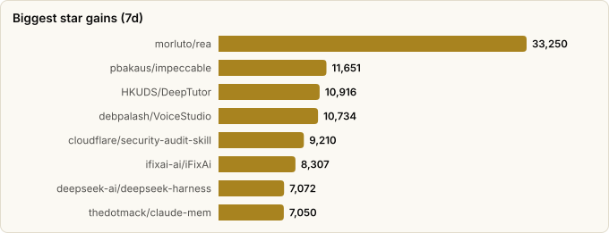

# Trending Now — What's Actually Moving in Your Stars

> Derived from **kaiser-data**'s 2,587 starred repos (snapshot `2026-11-02T14:17:38.270Z`), cross-referenced with the repo-similarity graph (2,587 nodes / 8,732 edges, 42 communities).
>
> Generated 2026-11-02 by `scripts/reports/trending_now.py` (regenerate any time — no API cost).

## Executive summary

- **This is the only report here that measures *change* rather than describing a landscape.** Every other report curates a taxonomy and renders it against the current vintage; this one diffs archived snapshots to show what actually moved.
- **Window**: `2026-10-26` → `2026-11-02` (**7 days**), covering the **2,404 repos** present in both snapshots. Long-run comparisons use `2026-06-11` → `2026-11-02` (**144 days**).
  - The immediately preceding snapshot (`2026-11-01`) is only 1 day before this one — too short to separate signal from noise — so the baseline was widened to the newest snapshot at least 7 days back.
- **1,867 repos gained stars** in the recent window, adding **426,738★** between them.
- **183 repos are new to the dataset** since the last refresh — newly starred, so they have no baseline to diff and are listed separately.
- **Measured, not estimated.** `classified.json` carries a `momentum` field, but it is a lifetime-stars/day proxy (its own source comment calls it "a serviceable proxy"). Everything below is observed snapshot-to-snapshot movement over a known number of days.

## How to read this

| Board | Question it answers | Bias to watch |
|---|---|---|
| **Fastest risers** | What gained the most stars outright? | Favours repos that are already huge — a 1% move on 100k stars beats a doubling at 500. |
| **Breakouts** | What grew fastest *relative to its size*? | Favours small repos; floored at 300★ baseline so noise doesn't win. |
| **Sustained climbers** | What has compounded over the long window? | Smooths out one-off spikes (a HN front page, a launch). |
| **New entrants** | What did you just start following? | Not growth at all — these have no baseline. |
| **Cooling off** | What is still growing, but much slower than it was? | Deceleration usually means a launch spike ending, not a project dying. |

## Fastest risers — absolute (2026-10-26 → 2026-11-02, 7d)

Raw star gain over the window. `Stars/day` normalizes for window length so this stays comparable across refreshes of different spacing.

| # | Repo | Gain | Stars/day | Stars now | Lang | Lifecycle | Activity |
|---|---|---|---|---|---|---|---|
| 1 | [morluto/rea](https://github.com/morluto/rea) | **+33,250** | 4750.0 | 421,141 | TypeScript | Hot | very active |
| 2 | [pbakaus/impeccable](https://github.com/pbakaus/impeccable) | **+11,651** | 1664.4 | 100,036 | Rust | Hot | very active |
| 3 | [HKUDS/DeepTutor](https://github.com/HKUDS/DeepTutor) | **+10,916** | 1559.4 | 54,119 | Python | Rising | very active |
| 4 | [debpalash/VoiceStudio](https://github.com/debpalash/VoiceStudio) | **+10,734** | 1533.4 | 98,602 | Python | Rising | very active |
| 5 | [cloudflare/security-audit-skill](https://github.com/cloudflare/security-audit-skill) | **+9,210** | 1315.7 | 56,972 | JavaScript | Declining | active |
| 6 | [ifixai-ai/iFixAi](https://github.com/ifixai-ai/iFixAi) | **+8,307** | 1186.7 | 42,979 | Python | Hot | very active |
| 7 | [deepseek-ai/deepseek-harness](https://github.com/deepseek-ai/deepseek-harness) | **+7,072** | 1010.3 | 269,160 | TypeScript | Hot | very active |
| 8 | [thedotmack/claude-mem](https://github.com/thedotmack/claude-mem) | **+7,050** | 1007.1 | 110,308 | TypeScript | Hot | very active |
| 9 | [stablyai/orca](https://github.com/stablyai/orca) | **+6,749** | 964.1 | 113,210 | TypeScript | Hot | very active |
| 10 | [affaan-m/ECC](https://github.com/affaan-m/ECC) | **+6,027** | 861.0 | 295,236 | JavaScript | Hot | very active |
| 11 | [DietrichGebert/ponytail](https://github.com/DietrichGebert/ponytail) | **+5,999** | 857.0 | 182,580 | JavaScript | Hot | very active |
| 12 | [obra/superpowers](https://github.com/obra/superpowers) | **+5,670** | 810.0 | 310,991 | Shell | Mature | active |
| 13 | [Leonxlnx/taste-skill](https://github.com/Leonxlnx/taste-skill) | **+5,621** | 803.0 | 108,342 | JavaScript | Hot | very active |
| 14 | [Graphify-Labs/graphify](https://github.com/Graphify-Labs/graphify) | **+5,202** | 743.1 | 140,900 | Python | Hot | very active |
| 15 | [Niko1221/Strata](https://github.com/Niko1221/Strata) | **+4,956** | 708.0 | 38,128 | C++ | Rising | very active |
| 16 | [heygen-com/hyperframes](https://github.com/heygen-com/hyperframes) | **+4,866** | 695.1 | 77,470 | TypeScript | Hot | very active |
| 17 | [TauricResearch/TradingAgents](https://github.com/TauricResearch/TradingAgents) | **+4,570** | 652.9 | 119,820 | Python | Mature | very active |
| 18 | [sindresorhus/awesome](https://github.com/sindresorhus/awesome) | **+4,438** | 634.0 | 529,352 | — | Mature | slowing |
| 19 | [tashfeenahmed/freellmapi](https://github.com/tashfeenahmed/freellmapi) | **+4,259** | 608.4 | 46,102 | TypeScript | Hot | very active |
| 20 | [multica-ai/andrej-karpathy-skills](https://github.com/multica-ai/andrej-karpathy-skills) | **+4,219** | 602.7 | 228,346 | — | Declining | stale |

## Breakouts — fastest relative growth (≥300★ baseline)

Percent growth over the same 7-day window. The baseline floor keeps small-number noise off the board — a repo going 8★ → 20★ is not a trend.

| # | Repo | Growth | Gain | Stars now | What it is |
|---|---|---|---|---|---|
| 1 | [fabio-rovai/open-ontologies](https://github.com/fabio-rovai/open-ontologies) | **+98%** | +1,367 | 2,757 | Plan, apply and roll back changes to a production ontology, with a blast radius report a… |
| 2 | [CopilotKit/OpenBot](https://github.com/CopilotKit/OpenBot) | **+37%** | +2,677 | 9,831 | Open-source AI coworkers that each get a computer of their own: a browser, files and too… |
| 3 | [Graphicle-AI/graphicle](https://github.com/Graphicle-AI/graphicle) | **+37%** | +132 | 493 | Code graph and memory for your coding agents, in one Rust program. For Claude Code, Code… |
| 4 | [termio-sh/termio](https://github.com/termio-sh/termio) | **+29%** | +172 | 757 | A terminal-first agentic development environment for agentic coding. Build for CLI/TUI a… |
| 5 | [HKUDS/DeepTutor](https://github.com/HKUDS/DeepTutor) | **+25%** | +10,916 | 54,119 | DeepTutor: Lifelong Personalized Tutoring. https://deeptutor.info/. |
| 6 | [ifixai-ai/iFixAi](https://github.com/ifixai-ai/iFixAi) | **+24%** | +8,307 | 42,979 | Independent Auditing of AI Agents. Run by human or the agent itself, to answer the most … |
| 7 | [decodingai-magazine/building-a-coding-agent-from-scratch-course](https://github.com/decodingai-magazine/building-a-coding-agent-from-scratch-course) | **+22%** | +200 | 1,099 | Learn harness engineering by building Claude Code from scratch. Free, open-source course… |
| 8 | [HelixDB/helix-foundry](https://github.com/HelixDB/helix-foundry) | **+19%** | +324 | 1,990 | Connect your company's data, let an agent draft an ontology over it, and load it into He… |
| 9 | [cloudflare/security-audit-skill](https://github.com/cloudflare/security-audit-skill) | **+19%** | +9,210 | 56,972 | A coding-agent skill for multi-phase security audits with independently verified, machin… |
| 10 | [cporter202/agentic-ai-apis](https://github.com/cporter202/agentic-ai-apis) | **+15%** | +102 | 762 | The ultimate collection of APIs for building autonomous AI agents — 2,036 production-rea… |
| 11 | [Niko1221/Strata](https://github.com/Niko1221/Strata) | **+15%** | +4,956 | 38,128 | Qwen3.8-Flash-Next on any consumer hardware: one-click install for Windows / Linux. Stra… |
| 12 | [pbakaus/impeccable](https://github.com/pbakaus/impeccable) | **+13%** | +11,651 | 100,036 | The design vocabulary for your coding agent. Steer with polish and bolder, review with c… |
| 13 | [nateherkai/herk-edit-kit](https://github.com/nateherkai/herk-edit-kit) | **+13%** | +279 | 2,501 | Herk Edit Kit by Nate Herk: edit videos, reels, and YouTube Shorts with Codex or Claude … |
| 14 | [debpalash/VoiceStudio](https://github.com/debpalash/VoiceStudio) | **+12%** | +10,734 | 98,602 | VoiceStudio is the open-source, fully-local ElevenLabs alternative — voice cloning, voic… |
| 15 | [spotify/portal-ai-plugins](https://github.com/spotify/portal-ai-plugins) | **+12%** | +304 | 2,823 | — |
| 16 | [rocketride-org/rocketride-server](https://github.com/rocketride-org/rocketride-server) | **+11%** | +1,911 | 19,643 | High-performance AI pipeline engine with a C++ core and 50+ Python-extensible nodes. Bui… |
| 17 | [NVIDIA/SkillSpector](https://github.com/NVIDIA/SkillSpector) | **+10%** | +2,259 | 23,947 | Security scanner for AI agent skills. Detect vulnerabilities, malicious patterns, securi… |
| 18 | [lightpanda-io/browser](https://github.com/lightpanda-io/browser) | **+10%** | +3,797 | 40,805 | Lightpanda: the headless browser designed for AI and automation |
| 19 | [tashfeenahmed/freellmapi](https://github.com/tashfeenahmed/freellmapi) | **+10%** | +4,259 | 46,102 | 7.4 billion tokens per month. 34 free LLM providers. 635 free model endpoints. All behin… |
| 20 | [mozilla-ai/otari](https://github.com/mozilla-ai/otari) | **+10%** | +74 | 812 | Open-source, OpenAI-compatible LLM gateway you run yourself. One endpoint for 40+ provid… |

## Sustained climbers — long run (2026-06-11 → 2026-11-02, 144d)

Averaged over the full snapshot history, so a single viral week doesn't dominate. Repos high here *and* in the recent board are compounding, not spiking.

| # | Repo | Stars/day | Total gain | Stars now | Lang | Health |
|---|---|---|---|---|---|---|
| 1 | [obra/superpowers](https://github.com/obra/superpowers) | **599.0** | +86,257 | 310,991 | Shell | 64 |
| 2 | [affaan-m/ECC](https://github.com/affaan-m/ECC) | **568.1** | +81,802 | 295,236 | JavaScript | 79 |
| 3 | [NousResearch/hermes-agent](https://github.com/NousResearch/hermes-agent) | **477.5** | +68,757 | 259,690 | Python | 75 |
| 4 | [firecrawl/firecrawl](https://github.com/firecrawl/firecrawl) | **460.6** | +66,325 | 197,852 | TypeScript | 86 |
| 5 | [earendil-works/pi](https://github.com/earendil-works/pi) | **401.1** | +57,758 | 119,536 | TypeScript | 80 |
| 6 | [multica-ai/andrej-karpathy-skills](https://github.com/multica-ai/andrej-karpathy-skills) | **381.0** | +54,866 | 228,346 | — | 19 |
| 7 | [msitarzewski/agency-agents](https://github.com/msitarzewski/agency-agents) | **379.0** | +54,583 | 166,036 | Shell | 62 |
| 8 | [public-apis/public-apis](https://github.com/public-apis/public-apis) | **378.4** | +54,484 | 495,345 | Python | 64 |
| 9 | [sindresorhus/awesome](https://github.com/sindresorhus/awesome) | **378.3** | +54,471 | 529,352 | — | 48 |
| 10 | [nextlevelbuilder/ui-ux-pro-max-skill](https://github.com/nextlevelbuilder/ui-ux-pro-max-skill) | **372.7** | +53,672 | 144,110 | Python | 95 |
| 11 | [farion1231/cc-switch](https://github.com/farion1231/cc-switch) | **365.9** | +52,693 | 151,172 | Rust | 79 |
| 12 | [harry0703/MoneyPrinterTurbo](https://github.com/harry0703/MoneyPrinterTurbo) | **355.7** | +51,217 | 137,314 | Python | 85 |
| 13 | [anomalyco/opencode](https://github.com/anomalyco/opencode) | **352.8** | +50,804 | 224,004 | TypeScript | 79 |
| 14 | [heygen-com/hyperframes](https://github.com/heygen-com/hyperframes) | **351.8** | +50,657 | 77,470 | TypeScript | 79 |
| 15 | [usestrix/strix](https://github.com/usestrix/strix) | **329.1** | +47,386 | 73,332 | Python | 75 |
| 16 | [JuliusBrussee/caveman](https://github.com/JuliusBrussee/caveman) | **314.9** | +45,341 | 116,856 | Go | 84 |
| 17 | [DeusData/codebase-memory-mcp](https://github.com/DeusData/codebase-memory-mcp) | **310.2** | +44,675 | 47,992 | C | 76 |
| 18 | [codecrafters-io/build-your-own-x](https://github.com/codecrafters-io/build-your-own-x) | **307.4** | +44,267 | 558,696 | Markdown | 28 |
| 19 | [openai/codex](https://github.com/openai/codex) | **294.4** | +42,396 | 132,854 | Rust | 93 |
| 20 | [microsoft/markitdown](https://github.com/microsoft/markitdown) | **294.2** | +42,369 | 193,512 | Python | 89 |

## Emerging themes

The boards above are computed; this section is interpretation. Each theme groups movers that are rising for the same underlying reason.

### Skills as the packaging format for agent behaviour

_The single loudest signal in this dataset. A year ago you configured an agent with a prompt; now behaviour ships as a versioned, installable *skill* bundle — and the repos distributing those bundles are growing faster than the agents that consume them. Note what this implies: the moat is moving from the model to the instruction layer._

- **[affaan-m/ECC](https://github.com/affaan-m/ECC)** · 295,236★ · +6,027★ in 7d  
  The agent harness performance optimization system. Skills, instincts, memory, security, and research-first development for Claude Code, Codex, Opencode, Cursor and beyond.
- **[DietrichGebert/ponytail](https://github.com/DietrichGebert/ponytail)** · 182,580★ · +5,999★ in 7d  
  Makes your AI agent think like the laziest senior dev in the room. The best code is the code you never wrote.
- **[obra/superpowers](https://github.com/obra/superpowers)** · 310,991★ · +5,670★ in 7d  
  An agentic skills framework & software development methodology that works.
- **[multica-ai/andrej-karpathy-skills](https://github.com/multica-ai/andrej-karpathy-skills)** · 228,346★ · +4,219★ in 7d  
  A single CLAUDE.md file to improve Claude Code behavior, derived from Andrej Karpathy's observations on LLM coding pitfalls.
- **[nextlevelbuilder/ui-ux-pro-max-skill](https://github.com/nextlevelbuilder/ui-ux-pro-max-skill)** · 144,110★ · +3,472★ in 7d  
  An AI skill that provides design intelligence for building professional UI/UX across multiple platforms.
- **[anthropics/skills](https://github.com/anthropics/skills)** · 186,616★ · +2,739★ in 7d  
  Public repository for Agent Skills
- **[msitarzewski/agency-agents](https://github.com/msitarzewski/agency-agents)** · 166,036★ · +1,917★ in 7d  
  A complete AI agency at your fingertips - From frontend wizards to Reddit community ninjas, from whimsy injectors to reality checkers. Each agent is a specialized expert with personality, processes, and proven deliverables.
- **[ayghri/i-have-adhd](https://github.com/ayghri/i-have-adhd)** · 59,771★ · +977★ in 7d  
  A skill to stop your coding agent from burying the answer. ADHD-friendly output.
- **[garrytan/gstack](https://github.com/garrytan/gstack)** · 138,639★ · +864★ in 7d  
  Use Garry Tan's exact Claude Code setup: 23 opinionated tools that serve as CEO, Designer, Eng Manager, Release Manager, Doc Engineer, and QA
- **[hesreallyhim/awesome-claude-code](https://github.com/hesreallyhim/awesome-claude-code)** · 57,092★ · +518★ in 7d  
  A hand-picked collection of the finest of resources for the most awesome of agents, Claude Code, the undisputed champion of coding companions, from the unstoppable team at Anthropic PBC (no affiliation). A delectable showcase of top tier skills, ambidextrous agents, scintillating status lines, top notch developer tooling, and also we have plugins
- **[shanraisshan/claude-code-best-practice](https://github.com/shanraisshan/claude-code-best-practice)** · 68,458★ · +325★ in 7d  
  from vibe coding to agentic engineering - practice makes claude perfect

### Giving agents a memory of the codebase

_Retrieval over a codebase is being replaced by *pre-indexed structure* — graphs and persistent stores an agent can consult instead of re-reading files every session. This is the same insight the graph in this repo is built on, and it is now one of the fastest-moving categories in your stars._

- **[thedotmack/claude-mem](https://github.com/thedotmack/claude-mem)** · 110,308★ · +7,050★ in 7d  
  Persistent Context Across Sessions for Every Agent –  Captures everything your agent does during sessions, compresses it with AI, and injects relevant context back into future sessions. Works with Claude Code, OpenClaw, Codex, Gemini, Hermes, Copilot, OpenCode + More
- **[Graphify-Labs/graphify](https://github.com/Graphify-Labs/graphify)** · 140,900★ · +5,202★ in 7d  
  Turn any codebase, with its docs, SQL schemas, configs, and PDFs, into a queryable knowledge graph. A /graphify skill for Claude Code, Cursor, Codex, and Gemini CLI: local deterministic AST parsing, every edge explained, no vector store.
- **[Egonex-AI/Understand-Anything](https://github.com/Egonex-AI/Understand-Anything)** · 89,769★ · +1,428★ in 7d  
  Graphs that teach > graphs that impress. Turn any code into an interactive knowledge graph you can explore, search, and ask questions about. Works with Claude Code, Codex, Cursor, Copilot, Gemini CLI, and more.
- **[colbymchenry/codegraph](https://github.com/colbymchenry/codegraph)** · 76,220★ · +837★ in 7d  
  Pre-indexed code knowledge graph, auto syncs on code changes, for Claude Code, Codex, Gemini, Cursor, OpenCode, AntiGravity, Kiro, CoPilot, and Hermes Agent — fewer tokens, fewer tool calls, 100% local
- **[DeusData/codebase-memory-mcp](https://github.com/DeusData/codebase-memory-mcp)** · 47,992★ · +475★ in 7d  
  Local code intelligence for developers and AI agents. Connect code, docs and infrastructure in a persistent graph, with CBM Lens, MCP tools, agent integrations and change-aware test selection.
- **[TencentCloud/TencentDB-Agent-Memory](https://github.com/TencentCloud/TencentDB-Agent-Memory)** · 30,350★ · +384★ in 7d  
  TencentDB Agent Memory is a team-level memory hub for AI Agents — turning conversations, docs, and code into four reusable memory assets (Chat Memory, Skill, LLM-Wiki, Code-Graph) that are governed, shared, and equipped across agents and frameworks.
- **[topoteretes/cognee](https://github.com/topoteretes/cognee)** · 33,003★ · +235★ in 7d  
  Cognee is the open-source AI memory platform for agents. Give your AI agents persistent long-term memory with small models for free
- **[langchain-ai/openwiki](https://github.com/langchain-ai/openwiki)** · 17,676★ · +225★ in 7d  
  OpenWiki is a CLI that writes and maintains agent documentation for your codebase.
- **[repowise-dev/repowise](https://github.com/repowise-dev/repowise)** · 8,102★ · +184★ in 7d  
  Codebase intelligence for AI and humans: code health scores, auto-generated docs, git analytics, dead code detection, and architectural decisions via MCP.
- **[semantica-agi/semantica](https://github.com/semantica-agi/semantica)** · 14,395★ · +142★ in 7d  
  Graph-Native Infrastructure for Context and Accountable AI Systems
- **[zilliztech/claude-context](https://github.com/zilliztech/claude-context)** · 12,663★ · +16★ in 7d  
  Code search MCP for Claude Code. Make entire codebase the context for any coding agent.

### Frontier models on hardware you already own

_The counter-current to everything above: instead of making API calls cheaper, remove them. Big mixture-of-experts models are being squeezed onto consumer machines, and the repos doing it are among the fastest relative movers in the dataset._

- **[JustVugg/colibri](https://github.com/JustVugg/colibri)** · 46,226★ · +2,251★ in 7d  
  Run frontier MoE models on hardware you already own — pure C, zero deps, experts streamed from disk. Tiny engine, immense model. 🐦
- **[lyogavin/airllm](https://github.com/lyogavin/airllm)** · 41,584★ · +873★ in 7d  
  AirLLM 2.8T LLM inference with single 4GB GPU
- **[ggml-org/llama.cpp](https://github.com/ggml-org/llama.cpp)** · 133,146★ · +746★ in 7d  
  LLM inference in C/C++
- **[Mesh-LLM/mesh-llm](https://github.com/Mesh-LLM/mesh-llm)** · 3,801★ · +246★ in 7d  
  Distributed AI/LLM for the people. Share compute privately or publicly to power your agents and chat.
- **[microsoft/foundry-local](https://github.com/microsoft/foundry-local)** · 2,605★ · +6★ in 7d  
  —

### Token economics became a product category

_Context windows got bigger and people started paying for them. These repos exist purely to make agents cheaper to run — compressing tool output, trimming prompts, proxying calls. That a compression layer can add tens of thousands of stars in weeks says the cost pressure is real, not theoretical._

- **[Alishahryar1/free-claude-code](https://github.com/Alishahryar1/free-claude-code)** · 65,849★ · +2,253★ in 7d  
  Use Claude Code, Codex, Antigravity, VSCode, Pi, and OpenCode (and 6 other harnesses) for free (1.3B+ free tokens) from your terminal, app, IDE, or phone, and now from the browser with native browser sessions (multi-harness + multi-model) like OpenClaw (voice supported + ToS friendly)
- **[JustVugg/colibri](https://github.com/JustVugg/colibri)** · 46,226★ · +2,251★ in 7d  
  Run frontier MoE models on hardware you already own — pure C, zero deps, experts streamed from disk. Tiny engine, immense model. 🐦
- **[JuliusBrussee/caveman](https://github.com/JuliusBrussee/caveman)** · 116,856★ · +1,694★ in 7d  
  🪨 why use many token when few token do trick. Viral skill + proxy for coding agents that cuts 65% of tokens by talking like a caveman.
- **[headroomlabs-ai/headroom](https://github.com/headroomlabs-ai/headroom)** · 78,631★ · +759★ in 7d  
  Compress tool outputs, logs, files, and RAG chunks before they reach the LLM. 20% fewer tokens for coding agents, 60-95% fewer tokens for JSON, same answers. Library, proxy, MCP server.
- **[rtk-ai/rtk](https://github.com/rtk-ai/rtk)** · 85,300★ · +705★ in 7d  
  CLI proxy that reduces LLM token consumption by 60-90% on common dev commands. Single Rust binary, zero dependencies

### The coding-agent harness field is still splitting, not consolidating

_Terminal coding agents keep multiplying rather than converging on a winner, and a second layer has appeared above them: switchers, meta-harnesses, and orchestrators whose job is to manage the agents themselves._

- **[paperclipai/paperclip](https://github.com/paperclipai/paperclip)** · 110,144★ · +2,665★ in 7d  
  The open-source app everyone uses to manage agents at work
- **[NousResearch/hermes-agent](https://github.com/NousResearch/hermes-agent)** · 259,690★ · +2,464★ in 7d  
  The agent that grows with you
- **[farion1231/cc-switch](https://github.com/farion1231/cc-switch)** · 151,172★ · +2,322★ in 7d  
  A cross-platform desktop All-in-One assistant for Claude Code, Codex, OpenCode,DeepSeek Harness and more. Only official website: ccswitch.io
- **[anomalyco/opencode](https://github.com/anomalyco/opencode)** · 224,004★ · +2,272★ in 7d  
  The open source coding agent.
- **[openai/codex](https://github.com/openai/codex)** · 132,854★ · +1,872★ in 7d  
  Lightweight coding agent that runs in your terminal
- **[earendil-works/pi](https://github.com/earendil-works/pi)** · 119,536★ · +1,616★ in 7d  
  AI agent toolkit: unified LLM API, agent loop, TUI, coding agent CLI
- **[ruvnet/ruflo](https://github.com/ruvnet/ruflo)** · 80,601★ · +1,209★ in 7d  
  🌊 The original agent harness. Deploy intelligent multi-player swarms, coordinate autonomous workflows, and build conversational AI systems. Features adaptive memory, self-learning intelligence, federation, vector RAG integration, and native Claude Code / Codex / Hermes and many more Integrated
- **[anthropics/claude-code](https://github.com/anthropics/claude-code)** · 154,257★ · +837★ in 7d  
  Claude Code is an agentic coding tool that lives in your terminal, understands your codebase, and helps you code faster by executing routine tasks, explaining complex code, and handling git workflows - all through natural language commands.
- **[multica-ai/multica](https://github.com/multica-ai/multica)** · 54,629★ · +788★ in 7d  
  Make humans and AI agents work as one team — open-source and self-hostable.
- **[getpaseo/paseo](https://github.com/getpaseo/paseo)** · 22,802★ · +722★ in 7d  
  Orchestrate multiple coding agents from desktop and mobile
- **[OpenHands/OpenHands](https://github.com/OpenHands/OpenHands)** · 92,493★ · +609★ in 7d  
  🙌 OpenHands: AI-Driven Development
- **[bytedance/deer-flow](https://github.com/bytedance/deer-flow)** · 84,879★ · +440★ in 7d  
  An open-source long-horizon SuperAgent harness that researches, codes, and creates. With the help of sandboxes, memories, tools, skill, subagents and message gateway, it handles different levels of tasks that could take minutes to hours.
- **[code-yeongyu/oh-my-openagent](https://github.com/code-yeongyu/oh-my-openagent)** · 70,612★ · +267★ in 7d  
  OmO: Just type "mass ulw" keyword with your prompt. Now you are the master of graph engineering.
- **[1jehuang/jcode](https://github.com/1jehuang/jcode)** · 21,414★ · +200★ in 7d  
  High performance coding agent harness written in Rust, built for heavy multi-agent dev workflows
- **[vercel/eve](https://github.com/vercel/eve)** · 5,771★ · +92★ in 7d  
  The Open Framework for Building Agents

### Agents are leaving the terminal for specific jobs

_The generalist assistant is being joined by vertical agents pointed at one domain — pentesting, trading, tutoring, job hunting, video. These grow on usefulness to a specific audience rather than on developer-tool hype._

- **[HKUDS/DeepTutor](https://github.com/HKUDS/DeepTutor)** · 54,119★ · +10,916★ in 7d  
  DeepTutor: Lifelong Personalized Tutoring. https://deeptutor.info/.
- **[heygen-com/hyperframes](https://github.com/heygen-com/hyperframes)** · 77,470★ · +4,866★ in 7d  
  Write HTML. Render video. Built for agents.
- **[TauricResearch/TradingAgents](https://github.com/TauricResearch/TradingAgents)** · 119,820★ · +4,570★ in 7d  
  TradingAgents: Multi-Agents LLM Financial Trading Framework
- **[career-ops-hq/career-ops](https://github.com/career-ops-hq/career-ops)** · 79,456★ · +2,024★ in 7d  
  Open-source AI job search agent and job finder: scan job boards, score each job 1-5 against your CV before you apply, tailor an ATS-friendly resume and cover letter, get interview prep and an application tracker. It helps you fill in each application; you press Submit. Runs locally in Codex, OpenCode and other AI CLIs, or as a Claude Code plugin.
- **[usestrix/strix](https://github.com/usestrix/strix)** · 73,332★ · +1,327★ in 7d  
  Open-source AI penetration testing tool to find and fix your app’s vulnerabilities.
- **[HKUDS/Vibe-Trading](https://github.com/HKUDS/Vibe-Trading)** · 37,442★ · +726★ in 7d  
  "Vibe-Trading: Your Personal Trading Agent"
- **[jamiepine/voicebox](https://github.com/jamiepine/voicebox)** · 59,255★ · +682★ in 7d  
  The open-source AI voice studio. Clone, dictate, create.
- **[browser-use/browser-use](https://github.com/browser-use/browser-use)** · 119,826★ · +648★ in 7d  
  Open-source Python library for AI browser agents, plus Browser Use Cloud: stealth browsers and a hosted agent API.
- **[Zackriya-Solutions/meetily](https://github.com/Zackriya-Solutions/meetily)** · 32,381★ · +204★ in 7d  
  Privacy first AI meeting note taker. Download Free and open source granola, otter ai, fireflies alternative. Parakeet / Whisper live transcription, on-device speaker diarization, built on Rust. 100% local processing. Meetily (Meetly Ai - https://meetily.ai) is the #1 Self-hosted, Open-source Ai meeting note taker & Assistant for macOS & Windows
- **[Canner/WrenAI](https://github.com/Canner/WrenAI)** · 18,040★ · +64★ in 7d  
  GenBI (Generative BI) for AI agents, an open-source, governed text-to-SQL through an open context layer that turns natural-language questions into trusted dashboards, charts, and SQL across 20+ data sources, such as BigQuery, Snowflake, PostgreSQL, ClickHouse, Amazon Redshift, Databricks and more.

### Design and spec as agent-readable artifacts

_If an agent writes the code, the leverage moves upstream to the spec and the design system. These repos turn intent into something an agent can consume directly._

- **[nextlevelbuilder/ui-ux-pro-max-skill](https://github.com/nextlevelbuilder/ui-ux-pro-max-skill)** · 144,110★ · +3,472★ in 7d  
  An AI skill that provides design intelligence for building professional UI/UX across multiple platforms.
- **[github/spec-kit](https://github.com/github/spec-kit)** · 145,248★ · +2,291★ in 7d  
  💫 Toolkit to help you get started with SDD or any other process!
- **[VoltAgent/awesome-design-md](https://github.com/VoltAgent/awesome-design-md)** · 125,195★ · +1,591★ in 7d  
  A collection of DESIGN.md files analysis by popular brand design systems. Drop one into your project and let coding agents generate a matching UI.
- **[nexu-io/open-design](https://github.com/nexu-io/open-design)** · 105,468★ · +1,413★ in 7d  
  The 1st Collaborative AI Design Agent Workspace. Local-first and open source. Create motion, prototypes, websites, apps, dashboards, presentations, images, and videos with your team and AI agents. Share work, exchange feedback, and iterate together in one workspace.

## New entrants — newly starred since the last refresh

These joined the dataset during this window, so they have no baseline to diff. They are what *you* just found interesting, which is its own kind of trend signal.

| Repo | Stars | Lang | Lifecycle | What it is |
|---|---|---|---|---|
| [react/react](https://github.com/react/react) | 252,086 | JavaScript | Classic | The library for web and native user interfaces. |
| [trekhleb/javascript-algorithms](https://github.com/trekhleb/javascript-algorithms) | 196,716 | JavaScript | Mature | 📝 Algorithms and data structures implemented in JavaScript with explanations and lin… |
| [twbs/bootstrap](https://github.com/twbs/bootstrap) | 174,968 | MDX | Classic | The most popular HTML, CSS, and JavaScript framework for developing responsive, mobi… |
| [vercel/next.js](https://github.com/vercel/next.js) | 143,466 | JavaScript | Classic | The React Framework |
| [denoland/deno](https://github.com/denoland/deno) | 108,792 | Rust | Classic | A modern runtime for JavaScript and TypeScript. |
| [sveltejs/svelte](https://github.com/sveltejs/svelte) | 88,527 | JavaScript | Classic | web development for the rest of us |
| [abi/screenshot-to-code](https://github.com/abi/screenshot-to-code) | 80,981 | Python | Mature | Drop in a screenshot and convert it to clean code (HTML/Tailwind/React/Vue) |
| [nektos/act](https://github.com/nektos/act) | 72,518 | Go | Classic | Run your GitHub Actions locally 🚀 |
| [meta/docusaurus](https://github.com/meta/docusaurus) | 66,638 | TypeScript | Classic | Easy to maintain open source documentation websites. |
| [git/git](https://github.com/git/git) | 64,119 | C | Classic | Git Source Code Mirror - This is a publish-only repository but pull requests can be … |
| [TryGhost/Ghost](https://github.com/TryGhost/Ghost) | 55,656 | TypeScript | Classic | Independent technology for modern publishing, memberships, subscriptions and newslet… |
| [microsoft/VibeVoice](https://github.com/microsoft/VibeVoice) | 55,098 | Python | Mature | Open-Source Frontier Voice AI |
| [wagoodman/dive](https://github.com/wagoodman/dive) | 54,692 | Go | Mature | A tool for exploring each layer in a docker image |
| [dockur/windows](https://github.com/dockur/windows) | 54,024 | Shell | Mature | Windows inside a Docker container. |
| [cypress-io/cypress](https://github.com/cypress-io/cypress) | 51,020 | TypeScript | Classic | Fast, easy and reliable testing for anything that runs in a browser. |
| [Gathin23/cleanyourtv](https://github.com/Gathin23/cleanyourtv) | 49,845 | Python | Hot | Debloat any Android or Google TV over Wi-Fi and get an Apple TV-style home. |
| [moment/moment](https://github.com/moment/moment) | 47,884 | JavaScript | Classic | Parse, validate, manipulate, and display dates in javascript. |
| [helix-editor/helix](https://github.com/helix-editor/helix) | 46,767 | Rust | Mature | A post-modern modal text editor. |
| [ziglang/zig](https://github.com/ziglang/zig) | 43,261 | Zig | Declining | Moved to Codeberg |
| [trpc/trpc](https://github.com/trpc/trpc) | 40,763 | TypeScript | Classic | 🧙‍♀️  Move Fast and Break Nothing. End-to-end typesafe APIs made easy. |
| [vlang/v](https://github.com/vlang/v) | 38,084 | V | Classic | Simple, fast, safe, compiled language for developing maintainable software. Compiles… |
| [p-e-w/heretic](https://github.com/p-e-w/heretic) | 37,816 | Python | Hot | Training-free language model modification: Remove censorship, suppress slop, reduce … |
| [lerna/lerna](https://github.com/lerna/lerna) | 36,041 | TypeScript | Classic | Lerna is a fast, modern build system for managing and publishing multiple JavaScript… |
| [sahat/hackathon-starter](https://github.com/sahat/hackathon-starter) | 35,259 | JavaScript | Classic | A boilerplate for Node.js web applications |
| [huggingface/diffusers](https://github.com/huggingface/diffusers) | 34,851 | Python | Classic | 🤗 Diffusers: State-of-the-art diffusion models for image, video, and audio generatio… |
| [fishaudio/fish-speech](https://github.com/fishaudio/fish-speech) | 33,544 | Python | Classic | SOTA Open Source TTS |
| [influxdata/influxdb](https://github.com/influxdata/influxdb) | 31,795 | Rust | Mature | Scalable datastore for metrics, events, and real-time analytics |
| [ReactiveX/rxjs](https://github.com/ReactiveX/rxjs) | 31,715 | TypeScript | Mature | A reactive programming library for JavaScript |
| [openssl/openssl](https://github.com/openssl/openssl) | 31,163 | C | Classic | General purpose TLS and crypto library |
| [sampotts/plyr](https://github.com/sampotts/plyr) | 29,993 | JavaScript | Classic | Deprecated in favour of Video.js 10; security updates only. Simple HTML5, YouTube an… |
| [meta/zstd](https://github.com/meta/zstd) | 28,151 | C | Classic | Zstandard - Fast real-time compression algorithm |
| [phuryn/pm-skills](https://github.com/phuryn/pm-skills) | 27,621 | — | Rising | PM Skills Marketplace: 100+ agentic skills, commands, and plugins — from discovery t… |
| [squidfunk/mkdocs-material](https://github.com/squidfunk/mkdocs-material) | 27,594 | Python | Classic | Documentation that simply works |
| [typesense/typesense](https://github.com/typesense/typesense) | 27,076 | C++ | Classic | Open Source alternative to Algolia + Pinecone and an Easier-to-Use alternative to El… |
| [simple-icons/simple-icons](https://github.com/simple-icons/simple-icons) | 26,123 | JavaScript | Classic | SVG icons for popular brands |
| [dubinc/dub.link](https://github.com/dubinc/dub.link) | 25,080 | TypeScript | Classic | The modern link attribution platform. Loved by world-class engineering teams at Twil… |
| [deepseek-ai/DeepInfer](https://github.com/deepseek-ai/DeepInfer) | 24,976 | Python | Mature | DeepInfer: High-performance, large-scale inference framework for DeepSeek models |
| [dolthub/dolt](https://github.com/dolthub/dolt) | 24,800 | Go | Classic | Dolt – Git for Data |
| [meta/lexical](https://github.com/meta/lexical) | 23,992 | TypeScript | Classic | Lexical is an extensible text editor framework that provides excellent reliability, … |
| [valyala/fasthttp](https://github.com/valyala/fasthttp) | 23,503 | Go | Classic | Fast HTTP package for Go. Tuned for high performance. Zero memory allocations in hot… |
| _…and 143 more_ | | | | |

## Cooling off

Deceleration, not decline. These averaged ≥1★/day across the 144-day long window but are now running below 40% of that rate. Most are still gaining — just far more slowly than they were, which is usually the tail of a launch spike rather than a problem.

| Repo | Long-run ★/day | Recent ★/day | Now at | Last push | Lifecycle |
|---|---|---|---|---|---|
| [AndyMik90/Aperant](https://github.com/AndyMik90/Aperant) | 1.7 | -0.4 | **-25%** of prior pace | 4mo ago | Declining |
| [ultraworkers/claw-code](https://github.com/ultraworkers/claw-code) | 9.3 | -0.9 | **-9%** of prior pace | 1d ago | Hot |
| [hesamsheikh/awesome-openclaw-usecases](https://github.com/hesamsheikh/awesome-openclaw-usecases) | 2.1 | -0.1 | **-7%** of prior pace | 7mo ago | Declining |
| [hexo-ai/sia](https://github.com/hexo-ai/sia) | 6.5 | 0.3 | **4%** of prior pace | 2mo ago | Mature |
| [guofei9987/blind_watermark](https://github.com/guofei9987/blind_watermark) | 11.3 | 0.6 | **5%** of prior pace | 7mo ago | Declining |
| [FalkorDB/FalkorDB](https://github.com/FalkorDB/FalkorDB) | 41.4 | 2.3 | **6%** of prior pace | 0d ago | Classic |
| [guidance-ai/guidance](https://github.com/guidance-ai/guidance) | 2.2 | 0.1 | **7%** of prior pace | 5mo ago | Mature |
| [alibaba/zvec](https://github.com/alibaba/zvec) | 44.5 | 3.6 | **8%** of prior pace | 0d ago | Hot |
| [charmbracelet/bubbles](https://github.com/charmbracelet/bubbles) | 3.4 | 0.3 | **8%** of prior pace | 1d ago | Classic |
| [RyanCodrai/turbovec](https://github.com/RyanCodrai/turbovec) | 44.4 | 4.4 | **10%** of prior pace | 26d ago | Rising |
| [allenai/olmocr](https://github.com/allenai/olmocr) | 16.9 | 1.7 | **10%** of prior pace | 7mo ago | Declining |
| [python/cpython](https://github.com/python/cpython) | 32.1 | 3.3 | **10%** of prior pace | 0d ago | Classic |
| [andrewyng/aisuite](https://github.com/andrewyng/aisuite) | 17.8 | 2.0 | **11%** of prior pace | 1mo ago | Mature |
| [illuin-tech/colpali](https://github.com/illuin-tech/colpali) | 1.2 | 0.1 | **12%** of prior pace | 1mo ago | Mature |
| [dottxt-ai/outlines](https://github.com/dottxt-ai/outlines) | 14.2 | 1.9 | **13%** of prior pace | 1mo ago | Mature |

## Graph analysis — where the movement clusters

**Community clustering.** The top 40 risers span **18 of the graph's 42 communities** — the more concentrated they are, the more this looks like one trend rather than broad drift.

- **Community 6** (6): `pbakaus/impeccable`, `cloudflare/security-audit-skill`, `affaan-m/ECC`, `DietrichGebert/ponytail`, `cathrynlavery/diagram-design`, `awesome-selfhosted/awesome-selfhosted`
- **Community 26** (6): `ifixai-ai/iFixAi`, `stablyai/orca`, `Leonxlnx/taste-skill`, `Graphify-Labs/graphify`, `nextlevelbuilder/ui-ux-pro-max-skill`, `cheaper-inference/OmniRoute`
- **Community 5** (5): `thedotmack/claude-mem`, `ai-job-search-dev/ai-job-search`, `CopilotKit/OpenBot`, `NousResearch/hermes-agent`, `patchy631/ai-engineering-hub`
- **Community 16** (4): `deepseek-ai/deepseek-harness`, `sindresorhus/awesome`, `public-apis/public-apis`, `codecrafters-io/build-your-own-x`
- **Community 9** (3): `morluto/rea`, `tashfeenahmed/freellmapi`, `gitroomhq/postiz-app`
- **Community 28** (3): `lightpanda-io/browser`, `D4Vinci/Scrapling`, `firecrawl/firecrawl`
- **Community 4** (2): `HKUDS/DeepTutor`, `TauricResearch/TradingAgents`

**Direct links between risers** (similarity edges where both endpoints are climbing) — co-movement suggests a shared driver:

- `DietrichGebert/ponytail` ⇄ `affaan-m/ECC` (w=0.435) — topics: ai-agents, claude, claude-code, developer-tools
- `D4Vinci/Scrapling` ⇄ `firecrawl/firecrawl` (w=0.258) — topics: crawler, scraping, web-scraper, web-scraping
- `morluto/rea` ⇄ `heygen-com/hyperframes` (w=0.217) — topics: mcp, claude-code, typescript, ai
- `public-apis/public-apis` ⇄ `sindresorhus/awesome` (w=0.125) — topics: resources, lists

**What the risers are written in** — language mix of the top 40 movers:

- **Python** — 13
- **TypeScript** — 11
- **JavaScript** — 4
- **Rust** — 3
- **—** — 3
- **Shell** — 1
- **C++** — 1
- **Zig** — 1

## Methodology & caveats

- **Source**: `data/snapshots/*.json` diffed against `data/classified.json` + `public/data/graph.json`. No external calls; fully reproducible.
- **Snapshots available**: 2026-06-11, 2026-07-13, 2026-07-19, 2026-07-20, 2026-07-27, 2026-08-07, 2026-08-11, 2026-08-28, 2026-08-29, 2026-08-31, 2026-09-06, 2026-09-07, 2026-09-12, 2026-09-14, 2026-09-21, 2026-09-25, 2026-09-28, 2026-09-29, 2026-10-05, 2026-10-10, 2026-10-11, 2026-10-19, 2026-10-24, 2026-10-26, 2026-11-01, 2026-11-02 (26 vintages). `build_index.py` archives one per refresh, keyed by the dataset's `generatedAt` date.
- **Windows are uneven.** Snapshots are taken when the data is refreshed, not on a fixed cadence — consecutive vintages here range from 1 day to several weeks apart. The recent window therefore does not always use the immediately preceding snapshot: it uses the newest one at least 7 days back, because a 1-day window amplifies noise far more than it reveals movement. Per-day normalization keeps the boards comparable across refreshes either way.
- **Star counts are a popularity signal, not a quality one.** A launch post, a conference talk, or a newsletter mention moves stars without anything changing in the code.
- **Only repos present in both snapshots are diffed.** Newly starred repos appear under *New entrants* with no growth figure; unstarred repos silently drop out.
- **The theme layer is hand-written** against the computed boards and does not refresh itself. Re-curate it when the movers change shape.
- Re-run after a fresh `classified.json` to refresh every board.

Repos tracked: 2,404 · Window: 2026-10-26 → 2026-11-02 (7d) · Snapshot: 2026-11-02T14:17:38.270Z
