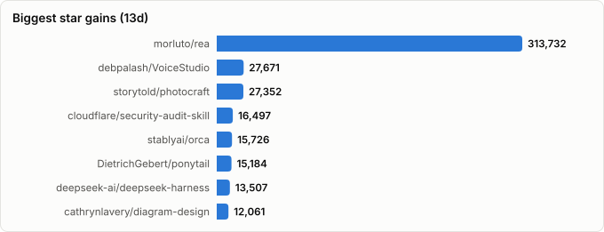

# Trending Now — What's Actually Moving in Your Stars

> Derived from **kaiser-data**'s 2,346 starred repos (snapshot `2026-10-11T13:10:52.436Z`), cross-referenced with the repo-similarity graph (2,346 nodes / 7,792 edges, 46 communities).
>
> Generated 2026-10-11 by `scripts/reports/trending_now.py` (regenerate any time — no API cost).

## Executive summary

- **This is the only report here that measures *change* rather than describing a landscape.** Every other report curates a taxonomy and renders it against the current vintage; this one diffs archived snapshots to show what actually moved.
- **Window**: `2026-09-29` → `2026-10-11` (**12 days**), covering the **2,245 repos** present in both snapshots. Long-run comparisons use `2026-06-11` → `2026-10-11` (**122 days**).
  - The immediately preceding snapshot (`2026-10-10`) is only 1 day before this one — too short to separate signal from noise — so the baseline was widened to the newest snapshot at least 7 days back.
- **1,798 repos gained stars** in the recent window, adding **559,481★** between them.
- **101 repos are new to the dataset** since the last refresh — newly starred, so they have no baseline to diff and are listed separately.
- **Measured, not estimated.** `classified.json` carries a `momentum` field, but it is a lifetime-stars/day proxy (its own source comment calls it "a serviceable proxy"). Everything below is observed snapshot-to-snapshot movement over a known number of days.

## How to read this

| Board | Question it answers | Bias to watch |
|---|---|---|
| **Fastest risers** | What gained the most stars outright? | Favours repos that are already huge — a 1% move on 100k stars beats a doubling at 500. |
| **Breakouts** | What grew fastest *relative to its size*? | Favours small repos; floored at 300★ baseline so noise doesn't win. |
| **Sustained climbers** | What has compounded over the long window? | Smooths out one-off spikes (a HN front page, a launch). |
| **New entrants** | What did you just start following? | Not growth at all — these have no baseline. |
| **Cooling off** | What is still growing, but much slower than it was? | Deceleration usually means a launch spike ending, not a project dying. |

## Fastest risers — absolute (2026-09-29 → 2026-10-11, 12d)

Raw star gain over the window. `Stars/day` normalizes for window length so this stays comparable across refreshes of different spacing.

| # | Repo | Gain | Stars/day | Stars now | Lang | Lifecycle | Activity |
|---|---|---|---|---|---|---|---|
| 1 | [debpalash/VoiceStudio](https://github.com/debpalash/VoiceStudio) | **+21,568** | 1797.3 | 56,902 | Python | Rising | very active |
| 2 | [vectorize-io/hindsight](https://github.com/vectorize-io/hindsight) | **+19,562** | 1630.2 | 47,962 | Python | Hot | very active |
| 3 | [paperclipai/paperclip](https://github.com/paperclipai/paperclip) | **+16,347** | 1362.2 | 99,522 | TypeScript | Hot | very active |
| 4 | [DietrichGebert/ponytail](https://github.com/DietrichGebert/ponytail) | **+14,504** | 1208.7 | 160,190 | JavaScript | Hot | very active |
| 5 | [deepseek-ai/deepseek-harness](https://github.com/deepseek-ai/deepseek-harness) | **+11,303** | 941.9 | 246,839 | TypeScript | Hot | very active |
| 6 | [stablyai/orca](https://github.com/stablyai/orca) | **+11,184** | 932.0 | 88,994 | TypeScript | Hot | very active |
| 7 | [rohitg00/ai-engineering-from-scratch](https://github.com/rohitg00/ai-engineering-from-scratch) | **+9,564** | 797.0 | 66,529 | Python | Hot | very active |
| 8 | [affaan-m/ECC](https://github.com/affaan-m/ECC) | **+9,135** | 761.2 | 276,293 | JavaScript | Hot | very active |
| 9 | [ifixai-ai/iFixAi](https://github.com/ifixai-ai/iFixAi) | **+7,644** | 637.0 | 23,366 | Python | Hot | very active |
| 10 | [heygen-com/hyperframes](https://github.com/heygen-com/hyperframes) | **+7,198** | 599.8 | 60,171 | TypeScript | Hot | very active |
| 11 | [sindresorhus/awesome](https://github.com/sindresorhus/awesome) | **+6,913** | 576.1 | 517,091 | — | Mature | active |
| 12 | [rocketride-org/rocketride-server](https://github.com/rocketride-org/rocketride-server) | **+6,490** | 540.8 | 17,803 | Python | Hot | very active |
| 13 | [cathrynlavery/diagram-design](https://github.com/cathrynlavery/diagram-design) | **+6,211** | 517.6 | 48,574 | HTML | Hot | very active |
| 14 | [cloudflare/security-audit-skill](https://github.com/cloudflare/security-audit-skill) | **+5,839** | 486.6 | 27,267 | JavaScript | Declining | active |
| 15 | [obra/superpowers](https://github.com/obra/superpowers) | **+5,744** | 478.7 | 297,121 | Shell | Hot | very active |
| 16 | [farion1231/cc-switch](https://github.com/farion1231/cc-switch) | **+5,687** | 473.9 | 142,363 | Rust | Hot | very active |
| 17 | [firecrawl/firecrawl](https://github.com/firecrawl/firecrawl) | **+5,632** | 469.3 | 190,116 | TypeScript | Mature | very active |
| 18 | [addyosmani/agent-skills](https://github.com/addyosmani/agent-skills) | **+5,407** | 450.6 | 104,357 | JavaScript | Hot | very active |
| 19 | [ayghri/i-have-adhd](https://github.com/ayghri/i-have-adhd) | **+5,183** | 431.9 | 56,247 | Python | Hot | very active |
| 20 | [t8y2/dbx](https://github.com/t8y2/dbx) | **+4,892** | 407.7 | 25,567 | Rust | Hot | very active |

## Breakouts — fastest relative growth (≥300★ baseline)

Percent growth over the same 12-day window. The baseline floor keeps small-number noise off the board — a repo going 8★ → 20★ is not a trend.

| # | Repo | Growth | Gain | Stars now | What it is |
|---|---|---|---|---|---|
| 1 | [fabio-rovai/open-ontologies](https://github.com/fabio-rovai/open-ontologies) | **+91%** | +485 | 1,020 | Plan, apply and roll back changes to a production ontology, with a blast radius report a… |
| 2 | [vectorize-io/hindsight](https://github.com/vectorize-io/hindsight) | **+69%** | +19,562 | 47,962 | Hindsight: Agent Memory That Learns |
| 3 | [debpalash/VoiceStudio](https://github.com/debpalash/VoiceStudio) | **+61%** | +21,568 | 56,902 | VoiceStudio is the open-source, fully-local ElevenLabs alternative — voice cloning, voic… |
| 4 | [rocketride-org/rocketride-server](https://github.com/rocketride-org/rocketride-server) | **+57%** | +6,490 | 17,803 | High-performance AI pipeline engine with a C++ core and 50+ Python-extensible nodes. Bui… |
| 5 | [ifixai-ai/iFixAi](https://github.com/ifixai-ai/iFixAi) | **+49%** | +7,644 | 23,366 | Independent Auditing of AI Agents. Run by human or the agent itself, to answer the most … |
| 6 | [Human-Agent-Society/reef](https://github.com/Human-Agent-Society/reef) | **+46%** | +2,380 | 7,521 | Infrastructure for continually self‑improving agents |
| 7 | [nateherkai/hyperframes-student-kit](https://github.com/nateherkai/hyperframes-student-kit) | **+39%** | +362 | 1,285 | Edit videos, reels, and YouTube Shorts with Codex or Claude Code. 14 skills, transcript-… |
| 8 | [FalkorDB/FalkorDB](https://github.com/FalkorDB/FalkorDB) | **+38%** | +2,375 | 8,671 | A super fast Graph Database uses GraphBLAS under the hood for its sparse adjacency matri… |
| 9 | [decodingai-magazine/building-a-coding-agent-from-scratch-course](https://github.com/decodingai-magazine/building-a-coding-agent-from-scratch-course) | **+34%** | +159 | 627 | Learn harness engineering by building Claude Code from scratch. Free, open-source course… |
| 10 | [EverMind-AI/Raven](https://github.com/EverMind-AI/Raven) | **+32%** | +1,289 | 5,356 | The Harness of Harnesses • built for RSI: a trusted, persistent, self-evolving multi-age… |
| 11 | [magnitudedev/magnitude](https://github.com/magnitudedev/magnitude) | **+31%** | +1,569 | 6,623 | Open source inference engine for agents that optimizes itself for your exact hardware. C… |
| 12 | [docker/skills](https://github.com/docker/skills) | **+30%** | +128 | 553 | A collection of Docker skills for AI coding agents to help them build, test, debug, and … |
| 13 | [jaredpalmer/kev](https://github.com/jaredpalmer/kev) | **+30%** | +2,052 | 8,886 | Jev-like family of decision models built on top of Qwen3.5/3.8 you can train and run on … |
| 14 | [mobile-next/mobile-mcp](https://github.com/mobile-next/mobile-mcp) | **+29%** | +1,981 | 8,874 | Model Context Protocol Server for Mobile Automation and Scraping (iOS, Android, Emulator… |
| 15 | [cloudflare/security-audit-skill](https://github.com/cloudflare/security-audit-skill) | **+27%** | +5,839 | 27,267 | A coding-agent skill for multi-phase security audits with independently verified, machin… |
| 16 | [Zefan-Cai/Open-Jev](https://github.com/Zefan-Cai/Open-Jev) | **+24%** | +77 | 402 | — |
| 17 | [t8y2/dbx](https://github.com/t8y2/dbx) | **+24%** | +4,892 | 25,567 | 25 MB lightweight cross-platform database client for 100+ databases, including MySQL, Po… |
| 18 | [gridex/gridex](https://github.com/gridex/gridex) | **+22%** | +332 | 1,852 | A native macOS / windows / Linux database IDE built with Swift and AppKit. Connect to Po… |
| 19 | [paperclipai/paperclip](https://github.com/paperclipai/paperclip) | **+20%** | +16,347 | 99,522 | The open-source app everyone uses to manage agents at work |
| 20 | [MakazhanAlpamys/Soup](https://github.com/MakazhanAlpamys/Soup) | **+18%** | +1,320 | 8,479 | Fine-tune LLMs from one YAML. Layer streaming trains an 8B model on a 4 GB laptop GPU. |

## Sustained climbers — long run (2026-06-11 → 2026-10-11, 122d)

Averaged over the full snapshot history, so a single viral week doesn't dominate. Repos high here *and* in the recent board are compounding, not spiking.

| # | Repo | Stars/day | Total gain | Stars now | Lang | Health |
|---|---|---|---|---|---|---|
| 1 | [obra/superpowers](https://github.com/obra/superpowers) | **593.3** | +72,387 | 297,121 | Shell | 74 |
| 2 | [affaan-m/ECC](https://github.com/affaan-m/ECC) | **515.2** | +62,859 | 276,293 | JavaScript | 79 |
| 3 | [NousResearch/hermes-agent](https://github.com/NousResearch/hermes-agent) | **504.3** | +61,520 | 252,453 | Python | 81 |
| 4 | [firecrawl/firecrawl](https://github.com/firecrawl/firecrawl) | **480.2** | +58,589 | 190,116 | TypeScript | 84 |
| 5 | [earendil-works/pi](https://github.com/earendil-works/pi) | **428.4** | +52,262 | 114,040 | TypeScript | 85 |
| 6 | [msitarzewski/agency-agents](https://github.com/msitarzewski/agency-agents) | **386.9** | +47,206 | 158,659 | Shell | 61 |
| 7 | [public-apis/public-apis](https://github.com/public-apis/public-apis) | **379.6** | +46,310 | 487,171 | Python | 64 |
| 8 | [multica-ai/andrej-karpathy-skills](https://github.com/multica-ai/andrej-karpathy-skills) | **364.5** | +44,468 | 217,948 | — | 20 |
| 9 | [nextlevelbuilder/ui-ux-pro-max-skill](https://github.com/nextlevelbuilder/ui-ux-pro-max-skill) | **360.4** | +43,973 | 134,411 | Python | 95 |
| 10 | [farion1231/cc-switch](https://github.com/farion1231/cc-switch) | **359.7** | +43,884 | 142,363 | Rust | 77 |
| 11 | [harry0703/MoneyPrinterTurbo](https://github.com/harry0703/MoneyPrinterTurbo) | **355.2** | +43,334 | 129,431 | Python | 80 |
| 12 | [DeusData/codebase-memory-mcp](https://github.com/DeusData/codebase-memory-mcp) | **352.2** | +42,966 | 46,283 | C | 76 |
| 13 | [sindresorhus/awesome](https://github.com/sindresorhus/awesome) | **346.0** | +42,210 | 517,091 | — | 50 |
| 14 | [usestrix/strix](https://github.com/usestrix/strix) | **342.3** | +41,763 | 67,709 | Python | 75 |
| 15 | [JuliusBrussee/caveman](https://github.com/JuliusBrussee/caveman) | **322.6** | +39,362 | 110,877 | Go | 79 |
| 16 | [anomalyco/opencode](https://github.com/anomalyco/opencode) | **322.1** | +39,297 | 212,497 | TypeScript | 88 |
| 17 | [microsoft/markitdown](https://github.com/microsoft/markitdown) | **313.2** | +38,210 | 189,353 | Python | 94 |
| 18 | [openai/codex](https://github.com/openai/codex) | **312.0** | +38,058 | 128,516 | Rust | 93 |
| 19 | [codecrafters-io/build-your-own-x](https://github.com/codecrafters-io/build-your-own-x) | **310.8** | +37,920 | 552,349 | Markdown | 37 |
| 20 | [nexu-io/open-design](https://github.com/nexu-io/open-design) | **302.4** | +36,897 | 100,351 | TypeScript | 87 |

## Emerging themes

The boards above are computed; this section is interpretation. Each theme groups movers that are rising for the same underlying reason.

### Skills as the packaging format for agent behaviour

_The single loudest signal in this dataset. A year ago you configured an agent with a prompt; now behaviour ships as a versioned, installable *skill* bundle — and the repos distributing those bundles are growing faster than the agents that consume them. Note what this implies: the moat is moving from the model to the instruction layer._

- **[DietrichGebert/ponytail](https://github.com/DietrichGebert/ponytail)** · 160,190★ · +14,504★ in 12d  
  Makes your AI agent think like the laziest senior dev in the room. The best code is the code you never wrote.
- **[affaan-m/ECC](https://github.com/affaan-m/ECC)** · 276,293★ · +9,135★ in 12d  
  The agent harness performance optimization system. Skills, instincts, memory, security, and research-first development for Claude Code, Codex, Opencode, Cursor and beyond.
- **[obra/superpowers](https://github.com/obra/superpowers)** · 297,121★ · +5,744★ in 12d  
  An agentic skills framework & software development methodology that works.
- **[ayghri/i-have-adhd](https://github.com/ayghri/i-have-adhd)** · 56,247★ · +5,183★ in 12d  
  A skill to stop your coding agent from burying the answer. ADHD-friendly output.
- **[msitarzewski/agency-agents](https://github.com/msitarzewski/agency-agents)** · 158,659★ · +4,089★ in 12d  
  A complete AI agency at your fingertips - From frontend wizards to Reddit community ninjas, from whimsy injectors to reality checkers. Each agent is a specialized expert with personality, processes, and proven deliverables.
- **[nextlevelbuilder/ui-ux-pro-max-skill](https://github.com/nextlevelbuilder/ui-ux-pro-max-skill)** · 134,411★ · +3,899★ in 12d  
  An AI skill that provides design intelligence for building professional UI/UX across multiple platforms.
- **[multica-ai/andrej-karpathy-skills](https://github.com/multica-ai/andrej-karpathy-skills)** · 217,948★ · +2,892★ in 12d  
  A single CLAUDE.md file to improve Claude Code behavior, derived from Andrej Karpathy's observations on LLM coding pitfalls.
- **[anthropics/skills](https://github.com/anthropics/skills)** · 180,291★ · +2,246★ in 12d  
  Public repository for Agent Skills
- **[garrytan/gstack](https://github.com/garrytan/gstack)** · 135,801★ · +1,640★ in 12d  
  Use Garry Tan's exact Claude Code setup: 23 opinionated tools that serve as CEO, Designer, Eng Manager, Release Manager, Doc Engineer, and QA
- **[shanraisshan/claude-code-best-practice](https://github.com/shanraisshan/claude-code-best-practice)** · 67,340★ · +1,019★ in 12d  
  from vibe coding to agentic engineering - practice makes claude perfect
- **[hesreallyhim/awesome-claude-code](https://github.com/hesreallyhim/awesome-claude-code)** · 55,355★ · +768★ in 12d  
  A hand-picked collection of the finest of resources for the most awesome of agents, Claude Code, the undisputed champion of coding companions, from the unstoppable team at Anthropic PBC (no affiliation). A delectable showcase of top tier skills, ambidextrous agents, scintillating status lines, top notch developer tooling, and also we have plugins

### Giving agents a memory of the codebase

_Retrieval over a codebase is being replaced by *pre-indexed structure* — graphs and persistent stores an agent can consult instead of re-reading files every session. This is the same insight the graph in this repo is built on, and it is now one of the fastest-moving categories in your stars._

- **[thedotmack/claude-mem](https://github.com/thedotmack/claude-mem)** · 99,136★ · +4,478★ in 12d  
  Persistent Context Across Sessions for Every Agent –  Captures everything your agent does during sessions, compresses it with AI, and injects relevant context back into future sessions. Works with Claude Code, OpenClaw, Codex, Gemini, Hermes, Copilot, OpenCode + More
- **[Graphify-Labs/graphify](https://github.com/Graphify-Labs/graphify)** · 125,191★ · +3,904★ in 12d  
  Turn any codebase, with its docs, SQL schemas, configs, and PDFs, into a queryable knowledge graph. A /graphify skill for Claude Code, Cursor, Codex, and Gemini CLI: local deterministic AST parsing, every edge explained, no vector store.
- **[Egonex-AI/Understand-Anything](https://github.com/Egonex-AI/Understand-Anything)** · 85,824★ · +1,695★ in 12d  
  Graphs that teach > graphs that impress. Turn any code into an interactive knowledge graph you can explore, search, and ask questions about. Works with Claude Code, Codex, Cursor, Copilot, Gemini CLI, and more.
- **[colbymchenry/codegraph](https://github.com/colbymchenry/codegraph)** · 73,659★ · +1,600★ in 12d  
  Pre-indexed code knowledge graph, auto syncs on code changes, for Claude Code, Codex, Gemini, Cursor, OpenCode, AntiGravity, Kiro, CoPilot, and Hermes Agent — fewer tokens, fewer tool calls, 100% local
- **[DeusData/codebase-memory-mcp](https://github.com/DeusData/codebase-memory-mcp)** · 46,283★ · +1,419★ in 12d  
  High-performance code intelligence MCP server. Indexes codebases into a persistent knowledge graph — average repo in milliseconds. 158 languages, sub-ms queries, 99% fewer tokens. Single static binary, zero dependencies.
- **[topoteretes/cognee](https://github.com/topoteretes/cognee)** · 31,948★ · +975★ in 12d  
  Cognee is the open-source AI memory platform for agents. Give your AI agents persistent long-term memory with small models for free
- **[TencentCloud/TencentDB-Agent-Memory](https://github.com/TencentCloud/TencentDB-Agent-Memory)** · 27,887★ · +623★ in 12d  
  TencentDB Agent Memory is a team-level memory hub for AI Agents — turning conversations, docs, and code into four reusable memory assets (Chat Memory, Skill, LLM-Wiki, Code-Graph) that are governed, shared, and equipped across agents and frameworks.
- **[semantica-agi/semantica](https://github.com/semantica-agi/semantica)** · 13,901★ · +443★ in 12d  
  Graph-Native Infrastructure for Context and Accountable AI Systems
- **[repowise-dev/repowise](https://github.com/repowise-dev/repowise)** · 7,429★ · +404★ in 12d  
  Codebase intelligence for AI and humans: code health scores, auto-generated docs, git analytics, dead code detection, and architectural decisions via MCP.
- **[langchain-ai/openwiki](https://github.com/langchain-ai/openwiki)** · 17,061★ · +280★ in 12d  
  OpenWiki is a CLI that writes and maintains agent documentation for your codebase.
- **[zilliztech/claude-context](https://github.com/zilliztech/claude-context)** · 12,597★ · +30★ in 12d  
  Code search MCP for Claude Code. Make entire codebase the context for any coding agent.

### Frontier models on hardware you already own

_The counter-current to everything above: instead of making API calls cheaper, remove them. Big mixture-of-experts models are being squeezed onto consumer machines, and the repos doing it are among the fastest relative movers in the dataset._

- **[JustVugg/colibri](https://github.com/JustVugg/colibri)** · 40,938★ · +3,344★ in 12d  
  Run frontier MoE models on hardware you already own — pure C, zero deps, experts streamed from disk. Tiny engine, immense model. 🐦
- **[ggml-org/llama.cpp](https://github.com/ggml-org/llama.cpp)** · 130,734★ · +1,258★ in 12d  
  LLM inference in C/C++
- **[lyogavin/airllm](https://github.com/lyogavin/airllm)** · 35,630★ · +846★ in 12d  
  AirLLM 70B inference with single 4GB GPU
- **[Mesh-LLM/mesh-llm](https://github.com/Mesh-LLM/mesh-llm)** · 3,492★ · +37★ in 12d  
  Distributed AI/LLM for the people. Share compute privately or publicly to power your agents and chat.
- **[microsoft/foundry-local](https://github.com/microsoft/foundry-local)** · 2,578★ · +14★ in 12d  
  —

### Token economics became a product category

_Context windows got bigger and people started paying for them. These repos exist purely to make agents cheaper to run — compressing tool output, trimming prompts, proxying calls. That a compression layer can add tens of thousands of stars in weeks says the cost pressure is real, not theoretical._

- **[JustVugg/colibri](https://github.com/JustVugg/colibri)** · 40,938★ · +3,344★ in 12d  
  Run frontier MoE models on hardware you already own — pure C, zero deps, experts streamed from disk. Tiny engine, immense model. 🐦
- **[JuliusBrussee/caveman](https://github.com/JuliusBrussee/caveman)** · 110,877★ · +3,107★ in 12d  
  🪨 why use many token when few token do trick. Viral skill + proxy for coding agents that cuts 65% of tokens by talking like a caveman.
- **[Alishahryar1/free-claude-code](https://github.com/Alishahryar1/free-claude-code)** · 57,261★ · +1,352★ in 12d  
  Use Claude Code, Codex, VSCode, Pi, and OpenCode (and 6 other harnesses) for free (1.3B+ free tokens) from your terminal, app, IDE, or phone, and now from the browser with native browser sessions (multi-harness + multi-model) like OpenClaw (voice supported + ToS friendly)
- **[rtk-ai/rtk](https://github.com/rtk-ai/rtk)** · 82,837★ · +1,150★ in 12d  
  CLI proxy that reduces LLM token consumption by 60-90% on common dev commands. Single Rust binary, zero dependencies
- **[headroomlabs-ai/headroom](https://github.com/headroomlabs-ai/headroom)** · 74,886★ · +1,129★ in 12d  
  Compress tool outputs, logs, files, and RAG chunks before they reach the LLM. 20% fewer tokens for coding agents, 60-95% fewer tokens for JSON, same answers. Library, proxy, MCP server.

### The coding-agent harness field is still splitting, not consolidating

_Terminal coding agents keep multiplying rather than converging on a winner, and a second layer has appeared above them: switchers, meta-harnesses, and orchestrators whose job is to manage the agents themselves._

- **[paperclipai/paperclip](https://github.com/paperclipai/paperclip)** · 99,522★ · +16,347★ in 12d  
  The open-source app everyone uses to manage agents at work
- **[farion1231/cc-switch](https://github.com/farion1231/cc-switch)** · 142,363★ · +5,687★ in 12d  
  A cross-platform desktop All-in-One assistant for Claude Code, Codex, OpenCode, OpenClaw, Grok Build & Hermes Agent. Only official website: ccswitch.io
- **[earendil-works/pi](https://github.com/earendil-works/pi)** · 114,040★ · +4,781★ in 12d  
  AI agent toolkit: unified LLM API, agent loop, TUI, coding agent CLI
- **[NousResearch/hermes-agent](https://github.com/NousResearch/hermes-agent)** · 252,453★ · +3,639★ in 12d  
  The agent that grows with you
- **[anomalyco/opencode](https://github.com/anomalyco/opencode)** · 212,497★ · +2,557★ in 12d  
  The open source coding agent.
- **[openai/codex](https://github.com/openai/codex)** · 128,516★ · +2,129★ in 12d  
  Lightweight coding agent that runs in your terminal
- **[anthropics/claude-code](https://github.com/anthropics/claude-code)** · 150,006★ · +1,989★ in 12d  
  Claude Code is an agentic coding tool that lives in your terminal, understands your codebase, and helps you code faster by executing routine tasks, explaining complex code, and handling git workflows - all through natural language commands.
- **[getpaseo/paseo](https://github.com/getpaseo/paseo)** · 20,376★ · +1,846★ in 12d  
  Orchestrate multiple coding agents from desktop and mobile
- **[OpenHands/OpenHands](https://github.com/OpenHands/OpenHands)** · 90,483★ · +1,353★ in 12d  
  🙌 OpenHands: AI-Driven Development
- **[multica-ai/multica](https://github.com/multica-ai/multica)** · 52,396★ · +1,073★ in 12d  
  Make humans and AI agents work as one team — open-source and self-hostable.
- **[ruvnet/ruflo](https://github.com/ruvnet/ruflo)** · 74,252★ · +1,014★ in 12d  
  🌊 The original agent harness. Deploy intelligent multi-player swarms, coordinate autonomous workflows, and build conversational AI systems. Features adaptive memory, self-learning intelligence, federation, vector RAG integration, and native Claude Code / Codex / Hermes and many more Integrated
- **[bytedance/deer-flow](https://github.com/bytedance/deer-flow)** · 83,646★ · +684★ in 12d  
  An open-source long-horizon SuperAgent harness that researches, codes, and creates. With the help of sandboxes, memories, tools, skill, subagents and message gateway, it handles different levels of tasks that could take minutes to hours.
- **[code-yeongyu/oh-my-openagent](https://github.com/code-yeongyu/oh-my-openagent)** · 69,937★ · +542★ in 12d  
  OmO: Just type "mass ulw" keyword with your prompt. Now you are the master of graph engineering.
- **[1jehuang/jcode](https://github.com/1jehuang/jcode)** · 20,378★ · +260★ in 12d  
  High performance coding agent harness written in rust
- **[vercel/eve](https://github.com/vercel/eve)** · 5,513★ · +153★ in 12d  
  The Open Framework for Building Agents

### Agents are leaving the terminal for specific jobs

_The generalist assistant is being joined by vertical agents pointed at one domain — pentesting, trading, tutoring, job hunting, video. These grow on usefulness to a specific audience rather than on developer-tool hype._

- **[heygen-com/hyperframes](https://github.com/heygen-com/hyperframes)** · 60,171★ · +7,198★ in 12d  
  Write HTML. Render video. Built for agents.
- **[usestrix/strix](https://github.com/usestrix/strix)** · 67,709★ · +3,002★ in 12d  
  Open-source AI penetration testing tool to find and fix your app’s vulnerabilities.
- **[TauricResearch/TradingAgents](https://github.com/TauricResearch/TradingAgents)** · 110,471★ · +1,931★ in 12d  
  TradingAgents: Multi-Agents LLM Financial Trading Framework
- **[browser-use/browser-use](https://github.com/browser-use/browser-use)** · 117,524★ · +1,288★ in 12d  
  Agents that use the browser.
- **[career-ops-hq/career-ops](https://github.com/career-ops-hq/career-ops)** · 73,953★ · +1,274★ in 12d  
  Open-source AI job search agent and job finder: scan job boards, score each job 1-5 against your CV before you apply, tailor an ATS-friendly resume and cover letter, get interview prep and a job application tracker. It helps you fill in each application; you press Submit. Runs locally in your AI coding CLI (Claude Code, Codex, OpenCode and more).
- **[jamiepine/voicebox](https://github.com/jamiepine/voicebox)** · 56,793★ · +1,140★ in 12d  
  The open-source AI voice studio. Clone, dictate, create.
- **[HKUDS/Vibe-Trading](https://github.com/HKUDS/Vibe-Trading)** · 35,120★ · +1,108★ in 12d  
  "Vibe-Trading: Your Personal Trading Agent"
- **[HKUDS/DeepTutor](https://github.com/HKUDS/DeepTutor)** · 41,081★ · +803★ in 12d  
  DeepTutor: Lifelong Personalized Tutoring. https://deeptutor.info/.
- **[Zackriya-Solutions/meetily](https://github.com/Zackriya-Solutions/meetily)** · 31,580★ · +485★ in 12d  
  Privacy first, AI meeting assistant with 4x faster Parakeet/Whisper live transcription, speaker diarization, and Ollama summarization built on Rust. 100% local processing. no cloud required. Meetily (Meetly Ai - https://meetily.ai) is the #1 Self-hosted, Open-source Ai meeting note taker for macOS & Windows. Understand How to write meeting minutes
- **[Canner/WrenAI](https://github.com/Canner/WrenAI)** · 17,835★ · +89★ in 12d  
  GenBI (Generative BI) for AI agents, an open-source, governed text-to-SQL through an open context layer that turns natural-language questions into trusted dashboards, charts, and SQL across 20+ data sources, such as BigQuery, Snowflake, PostgreSQL, ClickHouse, Amazon Redshift, Databricks and more.

### Design and spec as agent-readable artifacts

_If an agent writes the code, the leverage moves upstream to the spec and the design system. These repos turn intent into something an agent can consume directly._

- **[nextlevelbuilder/ui-ux-pro-max-skill](https://github.com/nextlevelbuilder/ui-ux-pro-max-skill)** · 134,411★ · +3,899★ in 12d  
  An AI skill that provides design intelligence for building professional UI/UX across multiple platforms.
- **[nexu-io/open-design](https://github.com/nexu-io/open-design)** · 100,351★ · +2,321★ in 12d  
  🎨 Best DeepSeek Harness Design Plugin. The open-source Claude Design alternative. 🖥️ Local-first desktop app. 🖼️ Your coding agent becomes the design engine: prototypes, landing pages, dashboards, slides, images & video — real files, HTML/PDF/PPTX/MP4 export. 🤖 Claude Code / Codex / Cursor / DeepSeek Harness / OpenCode & 20+ CLIs via BYOK.
- **[VoltAgent/awesome-design-md](https://github.com/VoltAgent/awesome-design-md)** · 120,137★ · +2,319★ in 12d  
  A collection of DESIGN.md files analysis by popular brand design systems. Drop one into your project and let coding agents generate a matching UI.
- **[github/spec-kit](https://github.com/github/spec-kit)** · 140,681★ · +1,856★ in 12d  
  💫 Toolkit to help you get started with SDD or any other process!

## New entrants — newly starred since the last refresh

These joined the dataset during this window, so they have no baseline to diff. They are what *you* just found interesting, which is its own kind of trend signal.

| Repo | Stars | Lang | Lifecycle | What it is |
|---|---|---|---|---|
| [shareAI-lab/learn-claude-code](https://github.com/shareAI-lab/learn-claude-code) | 78,351 | Python | Hot | Bash is all you need -  A nano claude code–like 「agent harness」, built from 0 to 1 |
| [666ghj/MiroFish](https://github.com/666ghj/MiroFish) | 78,024 | Python | Hot | A Simple and Universal Swarm Intelligence Engine, Predicting Anything. 简洁通用的群体智能引擎，预… |
| [openbq-org/OpenBB](https://github.com/openbq-org/OpenBB) | 74,069 | Python | Mature | Open Data Platform for analysts, quants and AI agents. |
| [morluto/rea](https://github.com/morluto/rea) | 63,358 | TypeScript | Hot | Reverse engineer anything with agents, from app behavior down to native binaries. |
| [storytold/photocraft](https://github.com/storytold/photocraft) | 44,932 | Rust | Hot | An open-source, clean-room reimplementation of Adobe Photoshop in pure Rust |
| [tinyhumansai/openhuman](https://github.com/tinyhumansai/openhuman) | 41,775 | Rust | Rising | The fastest, cheapest, most efficient open-source agent harness. Run more than 500 a… |
| [codewhale-hq/Codewhale](https://github.com/codewhale-hq/Codewhale) | 41,077 | Rust | Hot | Open-source Rust agent engine and terminal client for Codewhale, with provider choic… |
| [FreeCAD/FreeCAD](https://github.com/FreeCAD/FreeCAD) | 34,113 | C++ | Classic | Official source code of FreeCAD, a free and opensource multiplatform 3D parametric m… |
| [dandavison/delta](https://github.com/dandavison/delta) | 32,473 | Rust | Classic | A syntax-highlighting pager for git, diff, grep, rg --json, and blame output |
| [garrytan/gbrain](https://github.com/garrytan/gbrain) | 30,769 | TypeScript | Hot | Garry's Opinionated OpenClaw/Hermes Agent Brain |
| [Infisical/infisical](https://github.com/Infisical/infisical) | 29,688 | TypeScript | Classic | Infisical is the open-source platform for secrets, certificates, and privileged acce… |
| [alirezarezvani/claude-skills](https://github.com/alirezarezvani/claude-skills) | 27,998 | Python | Hot | 380 Claude Code skills & agent skills & plugins (30+ Agents, 70+ custom commands, 38… |
| [hardikpandya/stop-slop](https://github.com/hardikpandya/stop-slop) | 17,909 | — | Declining | A skill file for removing AI tells from prose |
| [alibaba/MNN](https://github.com/alibaba/MNN) | 16,206 | C++ | Classic | MNN: A blazing-fast, lightweight inference engine battle-tested by Alibaba, powering… |
| [NVIDIA/OpenShell](https://github.com/NVIDIA/OpenShell) | 15,678 | Rust | Hot | OpenShell is the safe, private runtime for autonomous AI agents. |
| [OrchestratorInc/agent-orchestrator](https://github.com/OrchestratorInc/agent-orchestrator) | 13,034 | Go | Hot | Run and supervise teams of coding agents from planning to merge. Any harness (Claude… |
| [IBM/sarama](https://github.com/IBM/sarama) | 12,524 | Go | Classic | Sarama is a Go library for Apache Kafka. |
| [manticoresoftware/manticoresearch](https://github.com/manticoresoftware/manticoresearch) | 12,049 | C++ | Classic | Open-source search database for full-text, vector, and hybrid search with real-time … |
| [IBM/plex](https://github.com/IBM/plex) | 11,685 | CSS | Mature | The package of IBM’s typeface, IBM Plex. |
| [microsoft/fast](https://github.com/microsoft/fast) | 9,675 | TypeScript | Classic | The adaptive interface system for modern web experiences. |
| [Open-Shell/Open-Shell-Menu](https://github.com/Open-Shell/Open-Shell-Menu) | 9,391 | C++ | Classic | Classic Shell Reborn. |
| [storytold/filmcraft](https://github.com/storytold/filmcraft) | 9,334 | Rust | Hot | An open-source, clean-room reimplementation of Adobe Premiere Pro built in pure Rust… |
| [delta-io/delta](https://github.com/delta-io/delta) | 9,040 | Scala | Classic | An open-source storage framework that enables building a Lakehouse architecture with… |
| [storytold/pdfcraft](https://github.com/storytold/pdfcraft) | 8,717 | Rust | Hot | An open-source, clean-room reimplementation of Adobe Acrobat built in pure Rust |
| [HarnessMD/munder-difflin](https://github.com/HarnessMD/munder-difflin) | 8,633 | TypeScript | Rising | an open-source alternative to the dots, bots and muses of the world, run an office o… |
| [storytold/lightcraft](https://github.com/storytold/lightcraft) | 8,501 | Rust | Hot | An open-source, clean-room reimplementation of Adobe Lightroom in pure Rust. |
| [supabase/realtime](https://github.com/supabase/realtime) | 7,647 | Elixir | Classic | Broadcast, Presence, and Postgres Changes via WebSockets |
| [mizorewww/laya-mlx](https://github.com/mizorewww/laya-mlx) | 6,870 | Python | Rising | Native MLX runtime for Laya typed decision models — 7–14 ms short decisions on M3 Ma… |
| [microsoft/aspire](https://github.com/microsoft/aspire) | 6,356 | C# | Classic | Aspire is the tool for code-first, extensible, observable dev and deploy. |
| [rileytestut/Delta](https://github.com/rileytestut/Delta) | 6,148 | Swift | Mature | Delta is an all-in-one classic video game emulator for non-jailbroken iOS devices. |
| [generalaction/emdash](https://github.com/generalaction/emdash) | 5,950 | TypeScript | Hot | Emdash is the Open-Source Agentic Development Environment (🧡 YC W26). Run multiple c… |
| [dmmulroy/anti-slop](https://github.com/dmmulroy/anti-slop) | 5,425 | TypeScript | Hot | Opinionated Oxlint rules for rejecting low-evidence TypeScript and JavaScript patter… |
| [pytorch/executorch](https://github.com/pytorch/executorch) | 5,087 | Python | Classic | On-device AI across mobile, embedded and edge for PyTorch |
| [langwatch/langwatch](https://github.com/langwatch/langwatch) | 4,933 | TypeScript | Classic | Open-Source Agent Observability & Evals for AI Platform teams. Trace, test, route an… |
| [Louis-CFM/coucou](https://github.com/Louis-CFM/coucou) | 4,757 | Swift | Hot | A tiny friend in your Mac's notch and on your iPhone that keeps an eye on your AI co… |
| [supabase/supabase-js](https://github.com/supabase/supabase-js) | 4,574 | TypeScript | Classic | An isomorphic Javascript client for Supabase. Query your Supabase database, subscrib… |
| [basicmachines-co/basic-memory](https://github.com/basicmachines-co/basic-memory) | 4,129 | Python | Hot | AI conversations that actually remember. Never re-explain your project to your AI ag… |
| [KoljaB/RealtimeTTS](https://github.com/KoljaB/RealtimeTTS) | 4,043 | Python | Classic | Converts text to speech in realtime |
| [cs341-illinois/coursebook](https://github.com/cs341-illinois/coursebook) | 3,806 | TeX | Classic | Open Source Introductory Systems Programming Textbook for the University of Illinois |
| [NVIDIA/cuda-rust](https://github.com/NVIDIA/cuda-rust) | 3,691 | Rust | Hot | NVIDIA's CUDA platform for Rust. Host runtime crates plus Tile (cutile-rs) and SIMT … |
| _…and 61 more_ | | | | |

## Cooling off

Deceleration, not decline. These averaged ≥1★/day across the 122-day long window but are now running below 40% of that rate. Most are still gaining — just far more slowly than they were, which is usually the tail of a launch spike rather than a problem.

| Repo | Long-run ★/day | Recent ★/day | Now at | Last push | Lifecycle |
|---|---|---|---|---|---|
| [hexabot-ai/Hexabot](https://github.com/hexabot-ai/Hexabot) | 1.5 | -8.8 | **-603%** of prior pace | 18d ago | Mature |
| [ultraworkers/claw-code](https://github.com/ultraworkers/claw-code) | 11.0 | -25.0 | **-227%** of prior pace | 1mo ago | Mature |
| [ValueCell-ai/valuecell](https://github.com/ValueCell-ai/valuecell) | 1.8 | -0.7 | **-36%** of prior pace | 7mo ago | Declining |
| [andrewyng/context-hub](https://github.com/andrewyng/context-hub) | 3.4 | -0.8 | **-24%** of prior pace | 4mo ago | Declining |
| [hesamsheikh/awesome-openclaw-usecases](https://github.com/hesamsheikh/awesome-openclaw-usecases) | 2.7 | -0.6 | **-22%** of prior pace | 6mo ago | Declining |
| [memodb-io/Acontext](https://github.com/memodb-io/Acontext) | 1.4 | -0.2 | **-18%** of prior pace | 2mo ago | Declining |
| [HKUDS/ClawWork](https://github.com/HKUDS/ClawWork) | 2.9 | -0.3 | **-12%** of prior pace | 7mo ago | Declining |
| [Mega4alik/ollm](https://github.com/Mega4alik/ollm) | 1.1 | -0.1 | **-8%** of prior pace | 2mo ago | Declining |
| [Avaiga/taipy](https://github.com/Avaiga/taipy) | 1.6 | -0.1 | **-5%** of prior pace | 2mo ago | Mature |
| [OpenDCAI/DataFlow](https://github.com/OpenDCAI/DataFlow) | 28.1 | -0.2 | **-1%** of prior pace | 13d ago | Mature |
| [OAI/OpenAPI-Specification](https://github.com/OAI/OpenAPI-Specification) | 1.8 | 0.0 | **0%** of prior pace | 2d ago | Classic |
| [meta-llama/prompt-ops](https://github.com/meta-llama/prompt-ops) | 1.8 | 0.0 | **0%** of prior pace | 5mo ago | Declining |
| [SuperClaude-Org/SuperClaude_Framework](https://github.com/SuperClaude-Org/SuperClaude_Framework) | 5.3 | 0.1 | **2%** of prior pace | 14d ago | Declining |
| [hexo-ai/sia](https://github.com/hexo-ai/sia) | 7.7 | 0.2 | **3%** of prior pace | 1mo ago | Mature |
| [andrewyng/aisuite](https://github.com/andrewyng/aisuite) | 20.6 | 1.4 | **7%** of prior pace | 23d ago | Mature |

## Graph analysis — where the movement clusters

**Community clustering.** The top 40 risers span **14 of the graph's 46 communities** — the more concentrated they are, the more this looks like one trend rather than broad drift.

- **Community 3** (7): `paperclipai/paperclip`, `DietrichGebert/ponytail`, `affaan-m/ECC`, `cloudflare/security-audit-skill`, `farion1231/cc-switch`, `ayghri/i-have-adhd`, `awesome-selfhosted/awesome-selfhosted`
- **Community 8** (7): `stablyai/orca`, `rohitg00/ai-engineering-from-scratch`, `heygen-com/hyperframes`, `cathrynlavery/diagram-design`, `addyosmani/agent-skills`, `diegosouzapw/OmniRoute`, `NousResearch/hermes-agent`
- **Community 4** (5): `ifixai-ai/iFixAi`, `earendil-works/pi`, `Graphify-Labs/graphify`, `nextlevelbuilder/ui-ux-pro-max-skill`, `JuliusBrussee/caveman`
- **Community 14** (4): `debpalash/VoiceStudio`, `rocketride-org/rocketride-server`, `VectifyAI/PageIndex`, `Tencent/WeKnora`
- **Community 5** (4): `vectorize-io/hindsight`, `thedotmack/claude-mem`, `msitarzewski/agency-agents`, `JustVugg/colibri`
- **Community 37** (3): `deepseek-ai/deepseek-harness`, `sindresorhus/awesome`, `public-apis/public-apis`
- **Community 9** (3): `firecrawl/firecrawl`, `calesthio/OpenMontage`, `D4Vinci/Scrapling`

**Direct links between risers** (similarity edges where both endpoints are climbing) — co-movement suggests a shared driver:

- `DietrichGebert/ponytail` ⇄ `affaan-m/ECC` (w=0.435) — topics: ai-agents, claude, claude-code, developer-tools
- `addyosmani/agent-skills` ⇄ `cathrynlavery/diagram-design` (w=0.342) — topics: agent-skills, claude-code, codex; authors: rudycelekli
- `JustVugg/colibri` ⇄ `vectorize-io/hindsight` (w=0.333) — authors: rudycelekli
- `JustVugg/colibri` ⇄ `msitarzewski/agency-agents` (w=0.333) — authors: rudycelekli
- `vectorize-io/hindsight` ⇄ `msitarzewski/agency-agents` (w=0.286) — authors: rudycelekli
- `vectorize-io/hindsight` ⇄ `thedotmack/claude-mem` (w=0.225) — topics: ai-memory; authors: rudycelekli
- `ayghri/i-have-adhd` ⇄ `affaan-m/ECC` (w=0.167) — topics: developer-tools, productivity
- `ayghri/i-have-adhd` ⇄ `DietrichGebert/ponytail` (w=0.143) — topics: claude-code-plugin, developer-tools
- `public-apis/public-apis` ⇄ `sindresorhus/awesome` (w=0.125) — topics: resources, lists

**What the risers are written in** — language mix of the top 40 movers:

- **Python** — 16
- **TypeScript** — 9
- **JavaScript** — 4
- **Go** — 3
- **—** — 2
- **Shell** — 2
- **Rust** — 2
- **HTML** — 1

## Methodology & caveats

- **Source**: `data/snapshots/*.json` diffed against `data/classified.json` + `public/data/graph.json`. No external calls; fully reproducible.
- **Snapshots available**: 2026-06-11, 2026-07-13, 2026-07-19, 2026-07-20, 2026-07-27, 2026-08-07, 2026-08-11, 2026-08-28, 2026-08-29, 2026-08-31, 2026-09-06, 2026-09-07, 2026-09-12, 2026-09-14, 2026-09-21, 2026-09-25, 2026-09-28, 2026-09-29, 2026-10-10, 2026-10-11 (20 vintages). `build_index.py` archives one per refresh, keyed by the dataset's `generatedAt` date.
- **Windows are uneven.** Snapshots are taken when the data is refreshed, not on a fixed cadence — consecutive vintages here range from 1 day to several weeks apart. The recent window therefore does not always use the immediately preceding snapshot: it uses the newest one at least 7 days back, because a 1-day window amplifies noise far more than it reveals movement. Per-day normalization keeps the boards comparable across refreshes either way.
- **Star counts are a popularity signal, not a quality one.** A launch post, a conference talk, or a newsletter mention moves stars without anything changing in the code.
- **Only repos present in both snapshots are diffed.** Newly starred repos appear under *New entrants* with no growth figure; unstarred repos silently drop out.
- **The theme layer is hand-written** against the computed boards and does not refresh itself. Re-curate it when the movers change shape.
- Re-run after a fresh `classified.json` to refresh every board.

Repos tracked: 2,245 · Window: 2026-09-29 → 2026-10-11 (12d) · Snapshot: 2026-10-11T13:10:52.436Z
